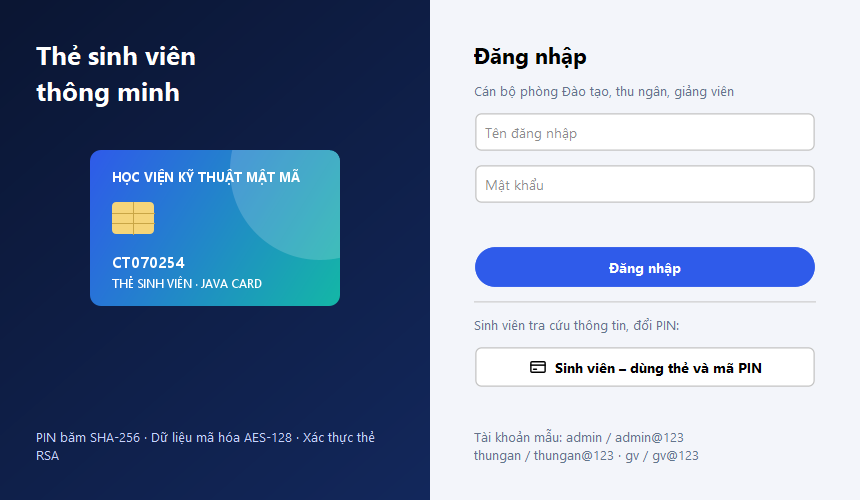
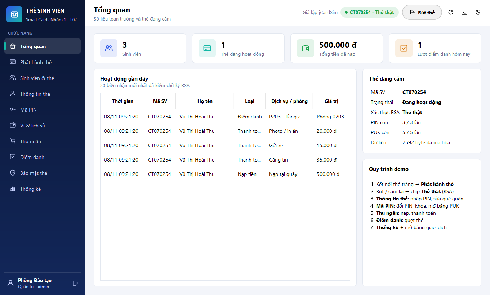
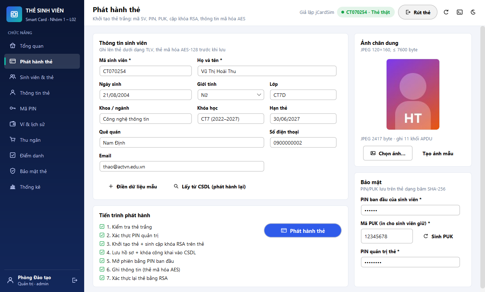
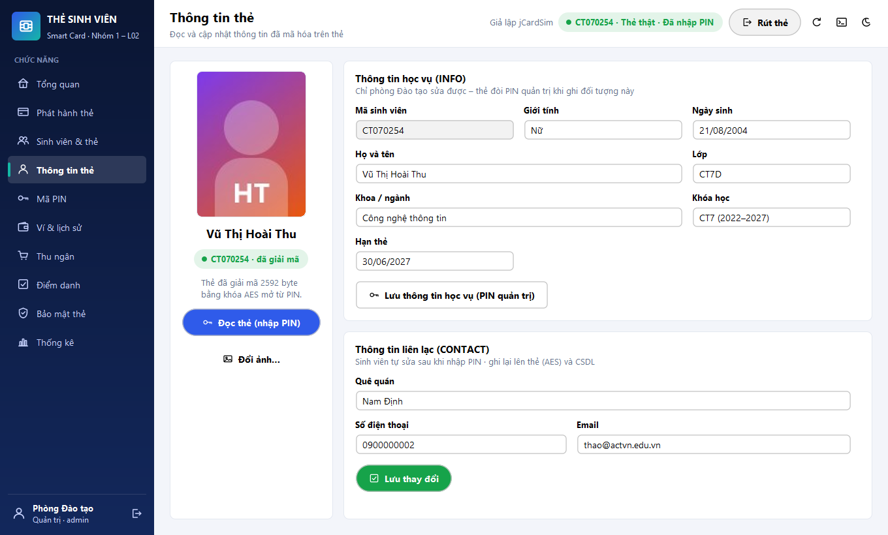
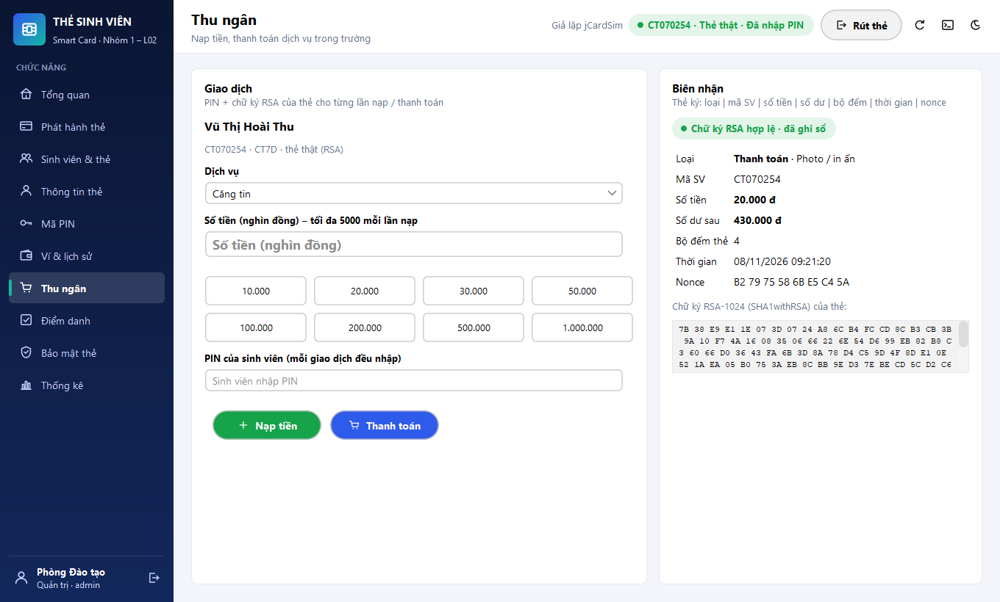
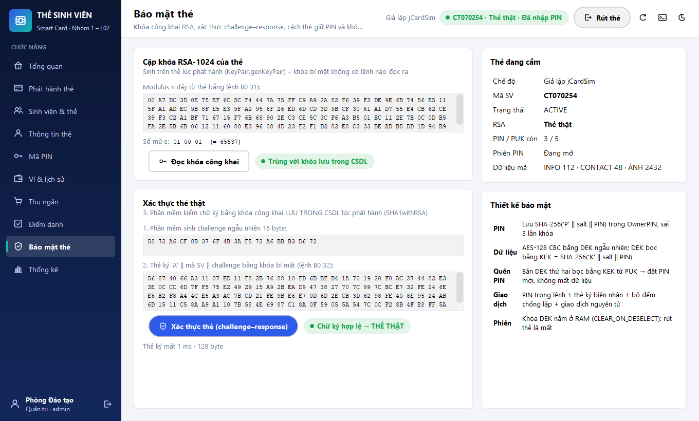

# Mã nguồn đề tài: Thẻ sinh viên (Nhóm 1 · L02)

> Đây là **bản hoàn chỉnh** của cả hai phần: applet Java Card và phần mềm máy tính (Java Swing + SQL Server). Các file trong `../th/` giải thích applet theo từng bài thực hành – vấn đáp sẽ hỏi từng dòng, nên mỗi người phải đọc hiểu phần mình trình bày.
> Kiểm chứng ngày 08/11/2026 bằng [run-test.cmd](run-test.cmd): **49/49 kịch bản** applet + thư viện + CSDL và **8/8 kiểm tra giao diện** (chạy đủ luồng qua các màn hình, chụp 14 ảnh). Chạy trên jCardSim 2.2.2 + SQLite. **Chưa chạy trên JCIDE và SQL Server thật** – lần đầu chạy theo [../04-moi-truong-cau-hinh.md](../04-moi-truong-cau-hinh.md) mục 7 và ghi kết quả vào nhật ký ở đó.

## Cấu trúc

```text
code/
├── applet/src/sinhvien/StudentCard.java   ← applet: chép vào project JCIDE (package sinhvien)
├── host/                                  ← THƯ MỤC PROJECT NETBEANS (Project Folder)
│   ├── app.properties                     ← cấu hình: card.mode, đầu đọc, AID, SQL Server, giao diện
│   ├── tai-thu-vien.cmd                   ← tải 4 jar vào lib\
│   ├── chay-phan-mem.cmd                  ← biên dịch + chạy không cần NetBeans
│   ├── lib/                               ← flatlaf, mssql-jdbc (jre8), sqlite-jdbc, jcardsim
│   └── src/sinhvien/
│       ├── host/                          ← lõi, không phụ thuộc giao diện
│       │   ├── AppConfig.java             đọc app.properties
│       │   ├── ApduChannel.java           giao diện "đường truyền APDU"
│       │   ├── PcscChannel.java           JCIDE / đầu đọc thật qua PC/SC (mở rộng SmartCardWord của cô)
│       │   ├── SimCardChannel.java        thẻ giả lập jCardSim chạy StudentCard ngay trong phần mềm
│       │   ├── LoggingChannel.java        nhật ký APDU (che PIN) cho console + khung trên giao diện
│       │   ├── CardClient.java            mỗi lệnh APDU = 1 hàm; SW -> thông báo tiếng Việt
│       │   ├── CardCrypto.java            đệm ISO 9797-1 M2, dựng khóa RSA, kiểm SHA1withRSA
│       │   ├── ProfileTlv.java            thông tin sinh viên dạng TLV (UTF-8)
│       │   ├── CardRepository.java        JDBC: đăng nhập, sinh viên, thẻ, biên nhận, thống kê
│       │   ├── DatabaseBootstrap.java     tự CREATE DATABASE + chạy schema + báo lỗi dễ hiểu
│       │   └── db/schema-sqlserver.sql, db/schema-sqlite.sql
│       └── ui/                            ← giao diện Swing + FlatLaf
│           ├── App.java                   main: cấu hình → giao diện → CSDL → phiên thẻ → đăng nhập
│           ├── LoginDialog.java           đăng nhập cán bộ / chế độ sinh viên
│           ├── MainView.java              thanh bên theo vai trò, header chip thẻ, khung Nhật ký APDU
│           ├── CardSession.java           trạng thái thẻ dùng chung (cắm/rút, thẻ thật, đã nhập PIN)
│           ├── Page.java, Task.java       khung màn hình; chạy việc chậm ngoài luồng giao diện
│           ├── Theme.java, Ui.java, Icons.java, BarChart.java, Fmt.java, Validators.java, ImageUtil.java, Dialogs.java
│           └── DashboardPage, IssueCardPage, StudentsPage, MyInfoPage, PinPage,
│               WalletPage, CashierPage, AttendancePage, SecurityPage, StatsPage
├── test/src/SimTest.java                  ← 49 kịch bản (applet + host + CSDL)
├── test/src/sinhvien/ui/UiShots.java      ← chạy luồng qua giao diện + chụp ảnh màn hình
└── run-test.cmd
```

## Chạy

| Muốn | Làm |
|---|---|
| Lần đầu | `host\tai-thu-vien.cmd` |
| Chạy trong NetBeans | Tạo project theo [04 mục 4](../04-moi-truong-cau-hinh.md#4-cấu-hình-project-netbeans), F6 |
| Chạy không cần NetBeans | `host\chay-phan-mem.cmd` |
| Xem thử khi chưa cài JCIDE / SQL Server | `app.properties`: `card.mode=jcardsim`, `db.url=jdbc:sqlite:the_sinh_vien.db` ([04 mục 4.4](../04-moi-truong-cau-hinh.md#44-chạy-nhanh-không-cần-netbeans--jcide--sql-server)) |
| Demo báo cáo | JCIDE Run + SQL Server, `card.mode=pcsc` ([04 mục 7](../04-moi-truong-cau-hinh.md#7-chạy-demo-đúng-chuẩn-báo-cáo-jcide--sql-server)) |
| Kiểm thử | `run-test.cmd` → hai dòng `TẤT CẢ … ĐỀU ĐÚNG` |

## Ảnh giao diện

Chụp bởi `UiShots` (thẻ giả lập + SQLite, dữ liệu mẫu của nhóm) – dùng được cho Chương 2 của báo cáo: [../images/giao-dien/](../images/giao-dien/).

| | |
|---|---|
|  |  |
|  |  |
|  |  |

## Khác biệt jCardSim ↔ JCIDE / thẻ thật cần biết

| Điểm | jCardSim 2.2.2 | JCIDE / thẻ JCOP |
|---|---|---|
| `SELECT` | Không nhận qua `transmitCommand` – `SimCardChannel` tự chuyển sang `selectAppletWithResult` | Gửi `00 A4 04 00 …` bình thường |
| Rút thẻ | `reset()` không xóa RAM → "Rút thẻ" = chọn applet khác để `deselect()` chạy (đúng kịch bản 1 của TH2) | Ngắt kết nối xóa `CLEAR_ON_RESET` và cờ PIN |
| Modulus RSA | 129 byte (có byte `00` đầu) | 128 byte; máy tính dùng `new BigInteger(1, …)` nên cả hai đều đúng |
| Sinh khóa RSA-1024 | ~0,1 giây | Giả lập vài giây; thẻ thật 2–15 giây |
| Thuật toán | Có SHA-256, khóa AES tạm | Chưa kiểm – applet tự lùi về SHA-1 / khóa AES bền nếu thiếu |

## Khi biên dịch bằng JDK mới hơn 8

Biên dịch ở mức Java 8 bằng JDK 11+ phải dùng `-source 8 -target 8`, **không** dùng `--release 8` (bộ API của `--release 8` thiếu `javax.smartcardio`). Các script `.cmd` dùng mặc định của JDK đang cài nên không gặp vấn đề này.
