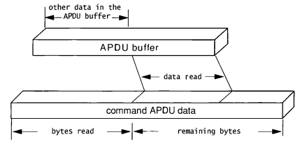

# APDU mở rộng

> Nguồn: `674871495-1762870638284-apdumorong.pdf` · 5 trang · Cao Vinh - CNTT
> Chuyển từ PDF sang Markdown ngày 03/11/2026. Hình giữ dạng ảnh; chữ, mã và thông số trong hình được chép lại ngay dưới ảnh.

Tính năng APDU mở rộng có từ tảng Java Card v2.2.2 trở đi, cho phép các nhà phát triển Applet tận dụng chức năng APDU mở rộng, như được định nghĩa trong đặc tả ISO 7816. APDU mở rộng cho phép một lượng lớn dữ liệu được gửi đến thẻ, được xử lý một cách thích hợp và được gửi trở lại thiết bị đầu cuối, theo cách hiệu quả hơn. Khi làm việc với khối dữ liệu lớn, nếu sử dụng APDU thông thường, các nhà phát triển phải gửi nhiều lần, nhưng với APDU mở rộng thì chỉ với một lần trao đổi là xong.

APDU mở rộng có lợi thế khi xử lý một lượng thông tin lớn. Ví dụ, các ứng dụng như xác minh chữ ký, xác minh sinh trắc học, lưu trữ và truy xuất hình ảnh có thể được tính năng này. Việc triển khai APDU mở rộng có thể dễ dàng được thực hiện nếu giao thức truyền tải cơ bản là T = 1, trong khi các applet được phát triển cho thẻ T = 0 sẽ cần sự cẩn thận và logic đặc biệt để hoạt động chính xác.

Trong hầu hết các trường hợp, phương thức `setIncomingAndReceive` đủ để đọc số byte dữ liệu vào bộ đệm APDU như được chỉ định trong trường Lc. Tuy nhiên, đối với một lệnh APDU có nhiều dữ liệu hơn mức có thể phù hợp với bộ đệm APDU, phương thức `setIncomingAndReceive` cần theo sau bởi một hoặc nhiều lệnh gọi đến phương thức `receiveBytes`:

```java
public short receiveBytes(short bOff) throws APDUException
```

Đối với dữ liệu lệnh APDU dài, Applet có thể xử lý dữ liệu từng phần và sau đó gọi phương thức `receiveBytes` để đọc dữ liệu bổ sung vào bộ đệm APDU. Với phương thức `receiveBytes`, phần bù vào bộ đệm APDU nơi dữ liệu được nhận có thể được chỉ định. Điều này cho phép Applet kiểm soát cách sử dụng bộ đệm APDU trong quá trình xử lý dữ liệu đến. Ví dụ, như trong hình 1, Applet có thể đã xử lý dữ liệu từ cuộc gọi trước đó đến phương thức `setIncomingAndReceive` hoặc phương thức `receiveBytes`, ngoại trừ một vài byte.



*Hình 1. Gọi phương thức `receiveBytes`*

Chữ trong hình:
- Thanh trên: APDU buffer; đoạn đầu thanh được đánh dấu "other data in the APDU buffer"
- Giữa hai thanh: data read (đoạn nối một phần của command APDU data với phần tiếp theo của APDU buffer)
- Thanh dưới: command APDU data; bên dưới chia thành hai đoạn: bytes read | remaining bytes

Applet có thể di chuyển các byte này vào đầu bộ đệm và sau đó nhận nhóm tiếp theo để nó được gắn vào các byte vẫn còn trong bộ đệm. Tính năng này rất quan trọng trong trường hợp dữ liệu được đọc trên các yêu cầu phương thức cần được xử lý toàn bộ.

Giống như phương thức `setIncomingAndReceive`, phương thức `receiveBytes` được đảm bảo trả về đồng bộ, lấy ra càng nhiều byte càng tốt. Tuy nhiên, tùy thuộc vào số lượng byte mà máy chủ sẽ gửi dưới dạng một lô và tùy thuộc vào việc triển khai JCRE, cả hai phương thức có thể đọc được ít byte hơn không gian có sẵn trong bộ đệm APDU.

Như một quy tắc chung, cả phương thức `setIncomingAndReceive` và phương thức `receiveBytes` đều được tối ưu hóa. Nếu toàn bộ dữ liệu lệnh phù hợp trong bộ đệm APDU bắt đầu ở phần bù `ISO7816.OFFSET_CDATA` (= 5), một lệnh gọi của phương thức `setIncomingAndReceive` sẽ đủ để nhận tất cả dữ liệu. Viêc gọi đến phương thức `receiveBytes` là không cần thiết. Hầu hết các lệnh APDU thuộc loại này.

Theo tiêu chuẩn của lớp javacard.framework.APDU thì độ dài của bộ đệm APDU tối thiểu phải từ 133 bytes (5 bytes tiêu đề và 128 bytes dữ liệu). Khi đó, chúng ta cần sử dụng phương thức `receiveBytes`. Nếu các byte còn lại vừa với không gian có sẵn ở phần bù được chỉ định trong bộ đệm APDU, phương thức `receiveBytes` được đảm bảo trả về với tất cả dữ liệu còn lại. Mặt khác, phương thức đọc nhiều byte sẽ phù hợp với bộ đệm và có thể ít hơn. Các Applet cần gọi `receiveBytes` nhiều lần, xử lý hoặc nhập các byte trong bộ đệm dữ liệu APDU với mỗi cuộc gọi, cho đến khi tất cả dữ liệu có sẵn được đọc. (Lưu ý: Bộ đệm APDU của thẻ JCOP chúng ta đang dùng là 261 byte)

Ví dụ sau bao hàm phương thức `receiveBytes` bên trong vòng lặp `while`:

```java
package bai7_APDU_Extended;

import javacard.framework.*;
import javacardx.apdu.ExtendedLength;

public class Applet1 extends Applet implements ExtendedLength
{
    private static byte temp[];
    private final static short MAX_SIZE = (short)1024;
    private final static byte INS_NHAP = (byte)0x01;
    private final static byte INS_XUAT = (byte)0x02;
    private static short dataLen;
    public static void install(byte[] bArray, short bOffset, byte bLength)
    {
        new Applet1().register(bArray, (short) (bOffset + 1), bArray[bOffset]);
        temp = new byte[MAX_SIZE];
    }

    public void process(APDU apdu)
    {
        if (selectingApplet())
        {
            return;
        }

        byte[] buf = apdu.getBuffer();

        short recvLen = apdu.setIncomingAndReceive();

        short pointer = 0;

        switch (buf[ISO7816.OFFSET_INS])
        {
        case INS_NHAP:
            dataLen = apdu.getIncomingLength();
            if (dataLen > MAX_SIZE)
            ISOException.throwIt(ISO7816.SW_WRONG_LENGTH);
            short dataOffset = apdu.getOffsetCdata();
            pointer = 0;
            while (recvLen > 0)
            {
            Util.arrayCopy(buf, dataOffset, temp, pointer, recvLen);
                pointer += recvLen;
                recvLen = apdu.receiveBytes(dataOffset);
            }
            break;
        case INS_XUAT:
            short toSend = dataLen;
            short le = apdu.setOutgoing();
            apdu.setOutgoingLength(toSend);
            short sendLen = 0;
            pointer = 0;
            while(toSend > 0)
            {
                sendLen = (toSend > le)?le:toSend;
                apdu.sendBytesLong(temp, pointer,sendLen);
                toSend -= sendLen;
                pointer += sendLen;

            }
            break;
        default:
        ISOException.throwIt(ISO7816.SW_INS_NOT_SUPPORTED);
        }
    }

}
```
