# Bài giảng: Tổng quan về thẻ thông minh

> Nguồn: `656784916-1793635505796-bai1-tongquanthethongminh.pdf` · 38 slide · ThS. Cao Vinh, Khoa Công nghệ thông tin, Học viện Kỹ thuật Mật mã
> Chuyển từ PDF sang Markdown ngày 03/11/2026. Hình giữ dạng ảnh; chữ, mã và thông số trong hình được chép lại ngay dưới ảnh. Ghi chú của người chuyển đổi bắt đầu bằng "Ghi chú chuyển đổi".

## Slide 1 · Trang bìa

- HỌC VIỆN KỸ THUẬT MẬT MÃ
- KHOA CÔNG NGHỆ THÔNG TIN
- Bài giảng: Tổng quan về thẻ thông minh
- ThS. Cao Vinh
- caovinh226@gmail.com
- “Tri thức là chìa khóa mở cánh cửa tương lai"

## Slide 2 · Nội dung chính

1. Lịch sử hình thành
2. Khái niệm, cấu tạo, phân loại TTM
3. Hệ thống bộ nhớ TTM
4. Phần cứng TTM
5. Truyền thông trên TTM

## Slide 3 · Lịch sử hình thành và phát triển thẻ thông minh

- 1950 xuất hiện thẻ làm bằng PVC
- Chức năng đơn giản, tên nhà phát hành được in trên bề mặt, dữ liệu cá nhân, tên chủ thẻ, số thẻ được gập nổi
- Có thẻ có bảng chữ ký

→ bảo vệ thẻ giả mạo bằng in bảo mật hay bảng chữ ký,…

→ kinh nghiệm của các tổ chức chấp nhận thẻ

→ Không đủ tính bảo mật

Cải tiến: một dải băng từ ở mặt sau của thẻ, cho phép lưu trữ dữ liệu kỹ thuật số có thể đọc trên máy

→ giảm thiểu việc ghi biên lai giấy trước đây, nhưng vẫn yêu cầu

→ Mục tiêu: thay thế giao dịch trên giấy bằng xử lý dữ liệu điện tử

→ Sử dụng mã PIN

→ Thẻ dập nổi với dải từ dài và mã PIN

## Slide 4 · Lịch sử hình thành và phát triển thẻ thông minh

- sử dụng thẻ dập nổi với dải từ dài có nhược điểm có thể thêm, sửa, xóa,..

→ sự ra đời của thẻ thông minh

- Có 2 ý tưởng chính dẫn tới sự hình thành và phát triển TTM
- Thẻ thông minh có nguồn gốc ở Pháp, Đức
- Sử dụng thẻ thông minh để làm thẻ điện thoại trả trước, thẻ ghi nợ và thẻ tín dụng
- Thời gian đầu, thẻ thông minh phát triển chậm trong lĩnh vực thẻ ngân hàng
- Gần đây với những tiến bộ trong công nghệ chip và mật mã hiện đại, thẻ thông minh ngày càng trở nên mạnh mẽ hơn. Chúng được sử dụng để lưu trữ tiền điện tử để thay thế tiền giấy, làn thẻ chứng minh thư nhân dân, hộ chiếu điện tử, thẻ thanh toán, lưu trữ và bảo mật hồ sơ y tế cá nhân, ngăn chặn các truy cập trái phép vào truyền hình cáp và vệ tinh, cải thiện tính bảo mật của điện thoại di động,...

## Slide 5 · Thẻ thông minh ở Việt Nam

Ứng dụng rất rộng rãi ở trong nhiều lĩnh vực như: ngân hàng, viễn thông, thương mại điện tử, điều khiển tự động, kiểm soát phương tiện.

***Ví dụ***

- CCCD gắn chip
- Thẻ ngân hang
- Sim điện thoại
- Thẻ thu phí tự động, thẻ nhân viên, thẻ sinh viên,…

## Slide 6 · Khái niệm thẻ thông minh

***Thẻ thông minh*** hay còn có tên gọi khác là *thẻ chip*, *thẻ mạch tích hợp* là một loại thẻ có kích thước giống như một thẻ tín dụng và được làm bằng nhựa, thường là PVC , đôi khi là ABS , thẻ có thể chứa một ảnh ba chiều.

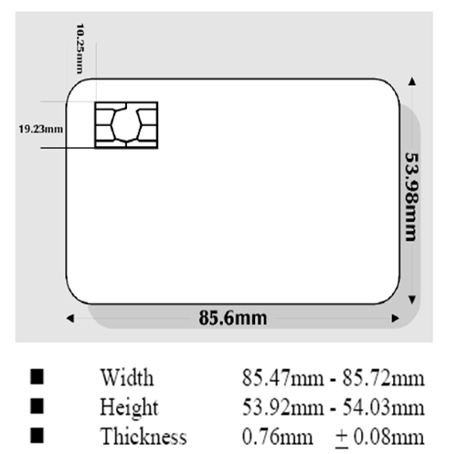

Chữ trong hình:
- Trên hình vẽ thẻ: 10.25mm, 19.23mm, 53.98mm, 85.6mm
- Width 85.47mm - 85.72mm
- Height 53.92mm - 54.03mm
- Thickness 0.76mm ± 0.08mm

## Slide 7 · Khái niệm thẻ thông minh

Kích thước theo tiêu chuẩn theo chuẩn :

- ID – 1 (ISO/IEC/7810)
- ID – 000

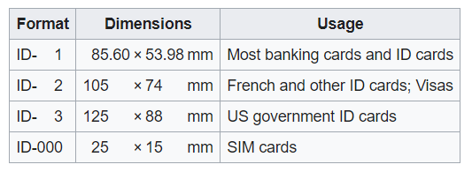

Chữ trong hình:

| Format | Dimensions | Usage |
|---|---|---|
| ID-1 | 85.60 × 53.98 mm | Most banking cards and ID cards |
| ID-2 | 105 × 74 mm | French and other ID cards; Visas |
| ID-3 | 125 × 88 mm | US government ID cards |
| ID-000 | 25 × 15 mm | SIM cards |

## Slide 8 · Khái niệm thẻ thông minh

Thẻ thông minh được gắn một con chip điện tử, có khả năng xử lý như một máy tính thu nhỏ

Ngoài khả năng lưu trữ dữ liệu, thẻ thông minh còn có khả năng xử lý dữ liệu tại chỗ → điểm khác thẻ từ

***Ví dụ***: Thẻ xe bus BRT

## Slide 9 · Phân loại thẻ thông minh

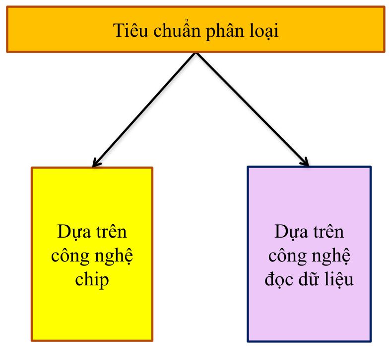

Chữ trong hình:
- Tiêu chuẩn phân loại → Dựa trên công nghệ chip
- Tiêu chuẩn phân loại → Dựa trên công nghệ đọc dữ liệu

## Slide 10 · Phân loại thẻ thông minh (1)

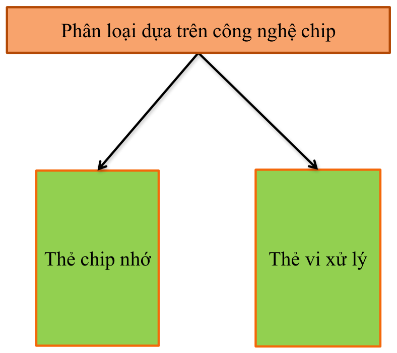

Chữ trong hình:
- Phân loại dựa trên công nghệ chip → Thẻ chip nhớ
- Phân loại dựa trên công nghệ chip → Thẻ vi xử lý

## Slide 11 · Thẻ chip nhớ

- ***Thế nào là thẻ chip nhớ?***
- chứa từ 1 đến 4 Kb dữ liệu nhưng vì không có bộ xử lý nào được nhúng bên trong thẻ nên chúng hoàn toàn bị phụ thuộc vào đầu đọc thẻ.
- thẻ chip nhớ giao tiếp với đầu đọc thẻ bằng một số giao thức đồng bộ
- thẻ chip nhớ thường chỉ có một bộ nhớ chỉ đọc (EEPROM) có thể lập trình, xóa bằng tín hiệu điện.
- thẻ chip nhớ không thể tái sử dụng

***Ưu điểm***

Thẻ chip nhớ có công nghệ đơn giản, dễ sản xuất, nhưng đó cũng chính là nhược điểm của nó, tính bảo mật không cao và rất dễ làm giả.

## Slide 12 · Thẻ chip vi xử lý

- ***Thế nào là thẻ chip vi xử lý?***
- là thẻ có chứa bộ xử lý bên trong nó
- có khả năng bảo mật cao vượt trội và đa chức năng hơn nhiều
- các ứng dụng bên ngoài không thể trực tiếp truy cập vào dữ liệu trong thẻ
- thẻ chip vi xử lý kiểm soát, xử lý dữ liệu và truy cập bộ nhớ theo một tập hợp các điều kiện nhất định (mật khẩu, mã hóa,…) và theo sự chỉ dẫn của các thiết bị ngoại vi
- hiện tại nhiều thẻ chip vi xử lý có tính năng hỗ trợ mã hóa tích hợp.

➔ Các thẻ như vậy đặc biệt hữu ích cho các ứng dụng đòi hỏi cao về bảo mật dữ liệu.

## Slide 13 · Phân loại thẻ thông minh (2)

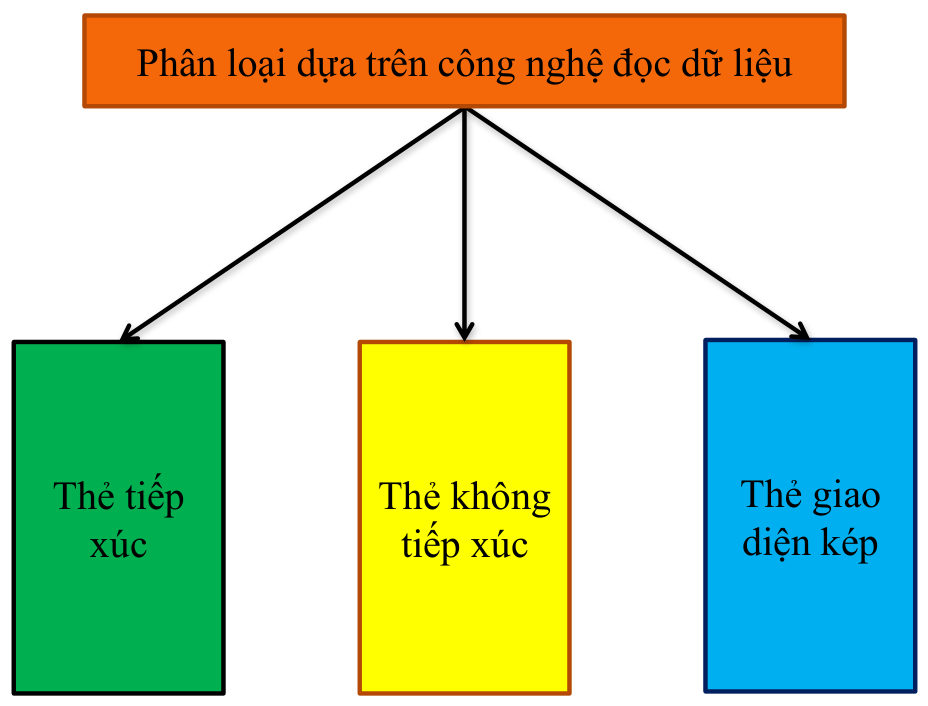

Chữ trong hình:
- Phân loại dựa trên công nghệ đọc dữ liệu → Thẻ tiếp xúc
- Phân loại dựa trên công nghệ đọc dữ liệu → Thẻ không tiếp xúc
- Phân loại dựa trên công nghệ đọc dữ liệu → Thẻ giao diện kép

## Slide 14 · Thẻ tiếp xúc (Contact Card)

- ***Thế nào là thẻ tiếp xúc?***

  Là loại thẻ có một diện tích tiếp xúc thường dễ nhận diện bởi có gắn con chip (màu vàng hoặc bạc) trên thân thẻ, tiếp điểm đó có diện tích khoảng 1cm², được chia thành các phần riêng biệt gồm đầu vào, đầu ra dữ liệu, tín hiệu reset, tín hiệu xung đồng hồ, chân điện áp.

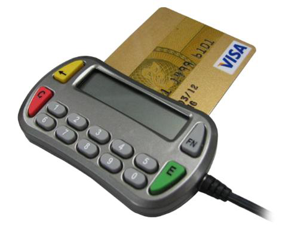

- ***Ưu điểm***
  - giá cả rẻ
  - đáp ứng nhiều tiêu chuẩn về CN
  - độ bảo mật cao
- ***Ví dụ*** Sim điện thoại

## Slide 15 · Thẻ không tiếp xúc (Contactless Card )

- ***Thế nào là thẻ không tiếp xúc ?***

  Là loại thẻ mà chip trên nó liên lạc với máy đọc thẻ thông qua công nghệ sóng vô tuyến RFID với tốc độ trao đổi dữ liệu từ 106 đến 848 kbit/s, thân thẻ chứa chip và đường dây ăng-ten được dấu ngầm.

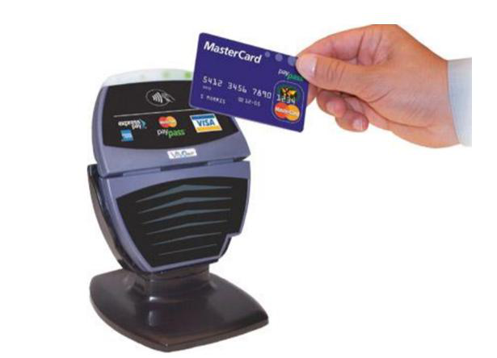

- ***Ví dụ***

  Kiểm soát giao thông công cộng, kiểm soát truy cập cho các tòa nhà

## Slide 16 · Thẻ giao diện kép (Dual-Interface Card)

- ***Thế nào là thẻ giao diện kép ?***

  Thẻ giao diện kép (Dual-Interface Card) là sự kết hợp của hai loại thẻ tiếp xúc và không tiếp xúc. Dữ liệu được truyền hoặc bằng phương pháp trực tiếp thẻ với đầu đọc hoặc gián tiếp qua tín hiệu vô tuyến.

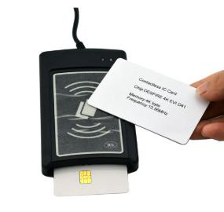

Chữ trong hình:
- Contactless IC Card
- Chip DESFIRE 4K EV1 D41
- Memory 4K byte
- Frequency 13.56MHz

> **Ghi chú chuyển đổi:** Chữ in trên thẻ trong ảnh rất nhỏ và mờ; bốn dòng trên là cách đọc gần đúng (ví dụ "EV1" cũng có thể là "EVI", "4K" ở dòng Memory có thể là "4k").

## Slide 17 · Phần cứng thẻ thông minh

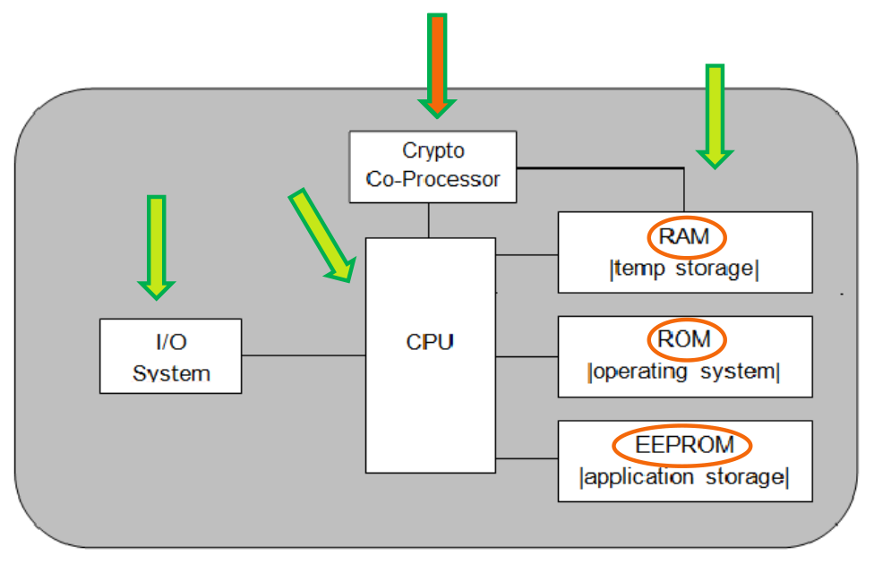

Chữ trong hình:
- Crypto Co-Processor
- I/O System
- CPU
- RAM |temp storage|
- ROM |operating system|
- EEPROM |application storage|

## Slide 18 · Hệ thống I/O

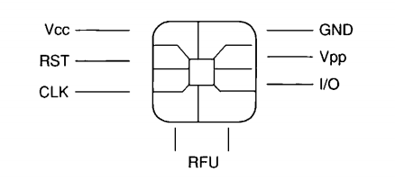

Chữ trong hình:
- Bên trái: Vcc, RST, CLK
- Bên phải: GND, Vpp, I/O
- Bên dưới: RFU

## Slide 19 · Bộ xử lý trung tâm CPU

- CPU trong hầu hết các thẻ thông minh hiện tại là một vi điều khiển 8-bit, thường sử dụng Motorola 6805 hoặc Itel 8051 với tốc độ xung nhịp lên đến 5 MHz.
- Thẻ thông minh cao cấp thường bao gồm bộ nhân xung nhịp (hệ số 2, 4 và 8), nó cho phép các thẻ này hoạt động đến 40 MHz.

> **Ghi chú chuyển đổi:** "Itel 8051" giữ nguyên như bản gốc; tên đúng của vi điều khiển là Intel 8051.

## Slide 20 · Bộ đồng xử lý

Chíp thẻ thông minh được thiết kế để sử dụng trong các ứng dụng bảo mật thường có bộ đồng xử lý tích hợp.

***Ví dụ***: bộ đồng xử lý mã hóa là một mạch tích hợp đặc biệt để tiến hành tính toán, đặc biệt là các phép tính modulo và tính toán số nguyên lớn.

## Slide 21 · Hệ thống bộ nhớ

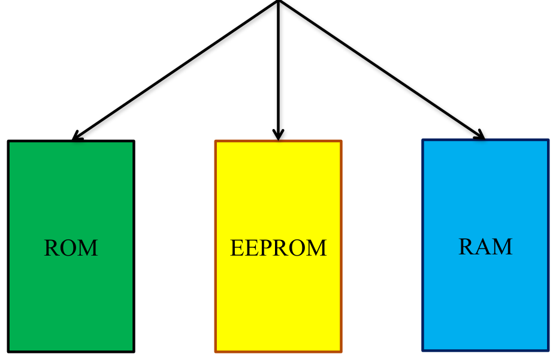

Chữ trong hình:
- ROM
- EEPROM
- RAM

## Slide 22 · ROM

- ROM (bộ nhớ chỉ đọc) được sử dụng để lưu trữ chương trình cố định của thẻ
- Việc lưu trữ dữ liệu trong loại bộ nhớ này không đòi hỏi năng lượng
- Bộ nhớ này không thể ghi vào sau khi thẻ được sản xuất

## Slide 23 · EEPROM

- EEPROM (bộ nhớ chỉ đọc, có thể lập trình, có thể xóa bằng điện), như ROM, có thể bảo toàn nội dung dữ liệu khi tắt nguồn cho bộ nhớ.
- Nội dung trong loại bộ nhớ này có thể được sửa đổi trong quá trình sử dụng thẻ thông thường.

➔ Do đó, nó được sử dụng để lưu trữ dữ liệu.

- Các ứng dụng người dùng cũng có thể được ghi vào EEPROM sau khi thẻ được tạo.
- Đọc từ EEPROM nhanh như đọc từ RAM, nhưng ghi vào EEPROM chậm hơn 1000 lần so với ghi vào RAM.

## Slide 24 · RAM (read)

- RAM (bộ nhớ truy cập ngẫu nhiên) được sử dụng như không gian làm việc tạm thời để lưu trữ và sửa đổi dữ liệu.
- RAM là bộ nhớ không cố định; nghĩa là, nội dung thông tin không được bảo tồn khi ngắt nguồn khỏi ô nhớ.
- RAM có thể được truy cập không giới hạn số lần và không áp dụng bất kỳ hạn chế nào như với EEPROM.

## Slide 25 · Hệ điều hành thẻ thông minh

***Ý nghĩa***

Hệ điều hành thẻ thông minh là phần mềm chạy trên vi xử lý của thẻ thông minh, nó cung cấp một giao diện chuẩn để quản lý các thành phần của thẻ.

***Nhiệm vụ của hệ điều hành***

- Trao đổi dữ liệu giữa thẻ và thiết bị đầu cuối;
- Thực thi lệnh điều khiển;
- Quản lý tập tin;
- Quản lý và thực hiện các thuật toán mã hóa;
- Quản lý và thực thi mã chương trình.

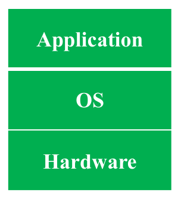

Chữ trong hình:
- Application
- OS
- Hardware

## Slide 26 · Hệ điều hành thẻ thông minh

***Phân loại:***

1) Hệ điều hành đóng
2) Hệ điều hành mở

***Ví dụ:***

1) CardOS, TCOS,…
2) JavaCardOS, MultOS, Windows for Smart Card

**JavaCardOS**

## Slide 27 · Hệ thống file trên thẻ thông minh

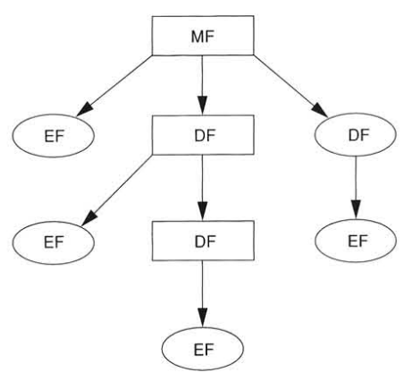

Chữ trong hình:
- MF
  - EF
  - DF
    - EF
    - DF
      - EF
  - DF
    - EF

## Slide 28 · Các tiêu chuẩn và đặc tả thẻ thông minh

- ISO 7816
- GSM
- EMV
- Nền tảng mở
- OpenCardFramework
- PC/SC

## Slide 29 · Truyền thông trên thẻ thông minh

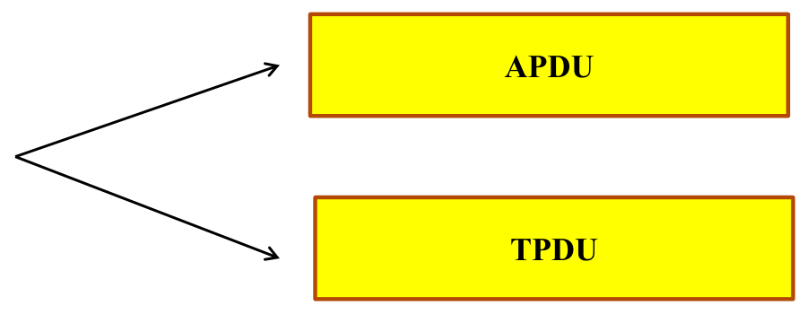

Chữ trong hình:
- APDU
- TPDU

## Slide 30 · Giao thức APDU

***Ý nghĩa***

Giao thức APDU (application protocol data unit) là giao thức cấp ứng dụng giữa thẻ thông minh và ứng dụng máy chủ. Các thông điệp APDU theo ISO 7816–4 bao gồm hai cấu trúc:

- APDU lệnh
- APDU phản hồi

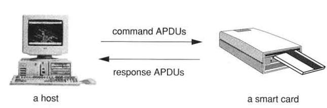

Chữ trong hình:
- a host → a smart card: command APDUs
- a smart card → a host: response APDUs

## Slide 31 · Giao thức APDU

***Cấu trúc APDU lệnh***

| Tiêu đề bắt buộc | Tiêu đề bắt buộc | Tiêu đề bắt buộc | Tiêu đề bắt buộc | Phần tùy chọn | Phần tùy chọn | Phần tùy chọn |
|---|---|---|---|---|---|---|
| CLA | INS | P1 | P2 | Lc | Trường dữ liệu | Le |

***Cấu trúc APDU phản hồi***

| Phần tùy chọn | Dấu vết (trailer) bắt buộc | Dấu vết (trailer) bắt buộc |
|---|---|---|
| Trường dữ liệu | SW1 | SW2 |

## Slide 32 · Cấu trúc APDU lệnh

***Cấu trúc APDU lệnh***

| Tiêu đề bắt buộc | Tiêu đề bắt buộc | Tiêu đề bắt buộc | Tiêu đề bắt buộc | Phần tùy chọn | Phần tùy chọn | Phần tùy chọn |
|---|---|---|---|---|---|---|
| CLA | INS | P1 | P2 | Lc | Trường dữ liệu | Le |

## Slide 33 · Cấu trúc APDU lệnh

***Cấu trúc APDU lệnh***

| Loại | Tên | Độ dài (byte) | Mô tả |
|---|---|---|---|
| CLA | Class | 1 | mã chỉ thị hay nhóm lệnh |
| INS | instruction | 1 | là mã lệnh |
| P1 | Parameter 1 | 1 | là tham số bắt buộc 1 |
| P2 | Parameter 2 | 1 | là tham số bắt buộc 2 |
| Lc | Length command | 0,1 **or 3** | là độ dài của trường dữ liệu |
| Data | Data | Lc | dữ liệu |
| Le | Length expected | 0, 1, **2 or 3** | là độ dài của trường dữ liệu phản hồi |

## Slide 34 · Cấu trúc APDU lệnh

***Cấu trúc APDU lệnh***

| Tiêu đề bắt buộc | Tiêu đề bắt buộc | Tiêu đề bắt buộc | Tiêu đề bắt buộc | Phần tùy chọn | Phần tùy chọn | Phần tùy chọn |
|---|---|---|---|---|---|---|
| CLA | INS | P1 | P2 | Lc | Trường dữ liệu | Le |

```text
A0 00 01 02 04 11 22 33 44
```

## Slide 35 · Cấu trúc APDU phản hồi

***Cấu trúc APDU phản hồi***

| Phần tùy chọn | Dấu vết (trailer) bắt buộc | Dấu vết (trailer) bắt buộc |
|---|---|---|
| Trường dữ liệu | SW1 | SW2 |

```text
90 00
```

| Loại | Tên | Độ dài (byte) | Mô tả |
|---|---|---|---|
| Data | Data |  | Dữ liệu phản hồi |
| SW1 | Status word 1 | 1 | Từ trạng thái 1 |
| SW2 | Status word 2 | 1 | Từ trạng thái 2 |

## Slide 36 · Giao thức APDU

APDU có thể được chia ra làm 4 loại:

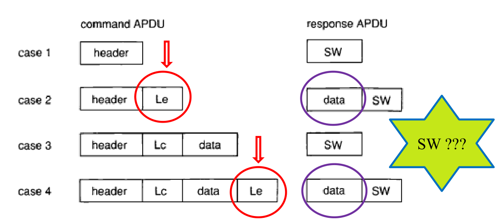

Chữ trong hình:

| | command APDU | response APDU |
|---|---|---|
| case 1 | header | SW |
| case 2 | header, Le | data, SW |
| case 3 | header, Lc, data | SW |
| case 4 | header, Lc, data, Le | data, SW |

- Hình ngôi sao: SW ???

## Slide 37 · Từ trạng thái (Status word)

***Ý nghĩa***

- Từ trạng thái là phần bắt buộc bao gồm hai trường SW1 và SW2
- Biểu thị trạng thái xử lý của thẻ sau khi thực hiện APDU lệnh.

***Ví dụ***

- Từ trạng thái “**0x9000**” có nghĩa là một lệnh đã được thực hiện thành công và trọn vẹn.
- Trong các trường hợp khác, từ trạng thái có thể chỉ ra:
  - Truy cập bị từ chối
  - Không tìm thấy file
  - Không có CLA hoặc INS nào như mong đợi,….


Chữ trong hình:
- 0x9000

## Slide 38 · Giao thức TPDU

***Ý nghĩa***

TPDU (Transport Protocol Data Unit – Đơn vị dữ liệu giao thức giao dịch) là giao thức truyền thông dùng để trao đổi cấu trúc dữ liệu giữa máy chủ và thẻ sử dụng.

***Cấu trúc của TPDU***

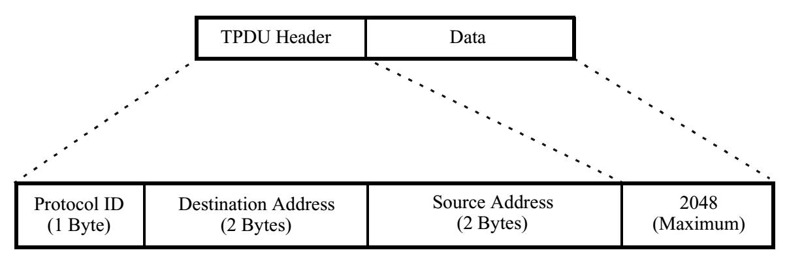

Chữ trong hình:
- TPDU Header
  - Protocol ID (1 Byte)
  - Destination Address (2 Bytes)
  - Source Address (2 Bytes)
- Data
  - 2048 (Maximum)

T = 0

T= 1
