# Bài 2: Giới thiệu về công nghệ Java Card

> Nguồn: `140875381-1793636920932-bai2-gioithieuchungvejavacard.pdf` · 17 slide · ThS. Cao Vinh, Khoa Công nghệ thông tin, Học viện Kỹ thuật Mật mã
> Chuyển từ PDF sang Markdown ngày 03/11/2026. Hình giữ dạng ảnh; chữ, mã và thông số trong hình được chép lại ngay dưới ảnh.

## Slide 1 · Trang bìa

- HỌC VIỆN KỸ THUẬT MẬT MÃ
- KHOA CÔNG NGHỆ THÔNG TIN
- Bài 2: Giới thiệu về công nghệ Java Card
- ThS. Cao Vinh
- caovinh226@gmail.com
- “Tri thức là chìa khóa mở cánh cửa tương lai"

## Slide 2 · Nội dung

- Giới thiệu chung
- Lịch sử của Java Card
- Kiến trúc chung của Java Card
- Các thành phần ứng dụng của Java Card
- Máy ảo Java
- Trình cài đặt Java Card
- Các bước xây dựng ứng dụng Java Card
- Môi trường thực thi Java Card

## Slide 3 · Java Card là gì ?

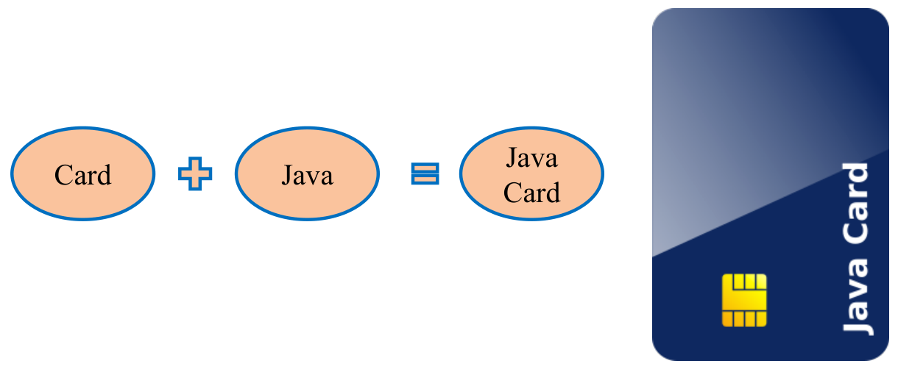

Chữ trong hình:

- Card + Java = Java Card
- Chữ trên hình thẻ: Java Card

## Slide 4 · Lịch sử phát triển của Java Card

| Năm | Phiên bản | Mô tả |
|---|---|---|
| 1996 | | Đề xuất công nghệ Java Card |
| 1997 | Java Card 2.0 | Nền tảng công nghệ |
| 1999 | Java Card 2.1 | Định dạng tập tin |
| 2000 | Java Card 2.1.1 | Bổ sung các thư viện mật mã |
| 2002 | Java Card 2.2 | Tiếp tục bổ sung thư viện mật mã, quản lý bộ nhớ |
| 2003 | Java Card 2.2.1 | Cải tiến cho USIM |
| 2006 | Java Card 2.2.2 | Bổ sung các hàm băm |
| 2009 | Java Card 3.0.1 | Bổ sung các hàm băm |
| 2011 | Java Card 3.0.4 | Bổ sung thư viện mật mã |
| 2015 | Java Card 3.0.5 | Bổ sung thư viện mật mã |
| 2018 | Java Card 3.1 | Bổ sung thư viện mật mã |

## Slide 5 · Kiến trúc chung

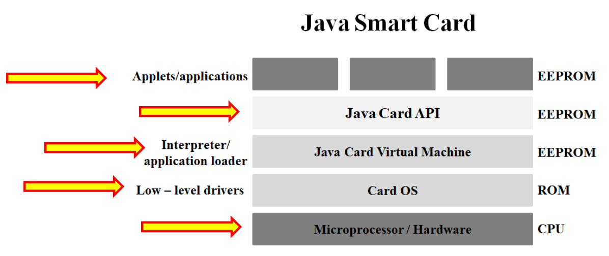

Chữ trong hình:

- Java Smart Card
- Các lớp, từ trên xuống:
  - Applets/applications (ba ô xám, không có chữ), bên phải: EEPROM
  - Java Card API, bên phải: EEPROM
  - Java Card Virtual Machine, bên trái: Interpreter/application loader, bên phải: EEPROM
  - Card OS, bên trái: Low – level drivers, bên phải: ROM
  - Microprocessor / Hardware, bên phải: CPU
- Năm mũi tên vàng viền đỏ chỉ vào các lớp

## Slide 6 · Các thành phần của ứng dụng Java Card

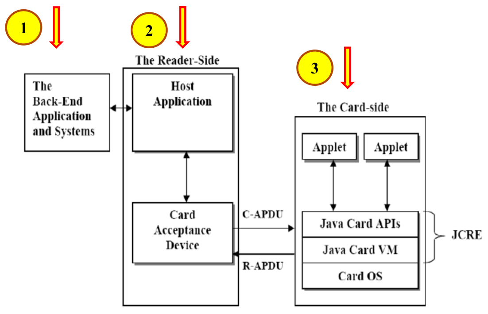

Chữ trong hình:

- 1: The Back-End Application and Systems
- 2: The Reader-Side, gồm Host Application và Card Acceptance Device
- 3: The Card-side, gồm Applet, Applet, Java Card APIs, Java Card VM, Card OS; ngoặc nhọn JCRE bao Java Card APIs và Java Card VM
- The Back-End Application and Systems ↔ Host Application
- Host Application ↔ Card Acceptance Device
- Card Acceptance Device → The Card-side: C-APDU
- The Card-side → Card Acceptance Device: R-APDU
- Mỗi Applet ↔ Java Card APIs

## Slide 7

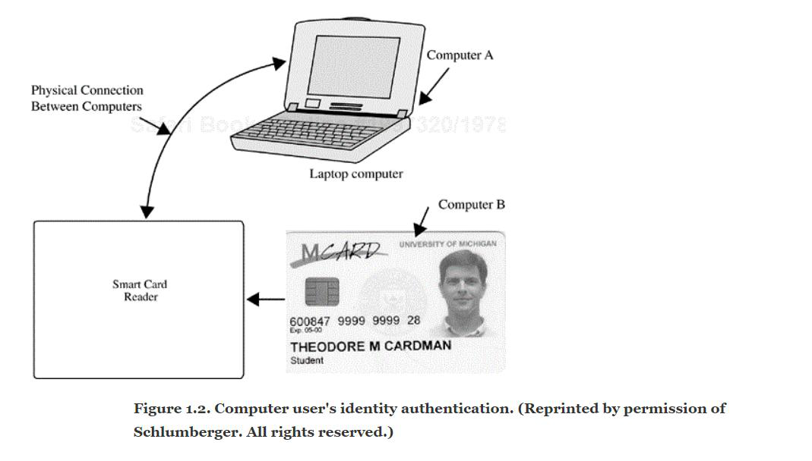

*Figure 1.2. Computer user's identity authentication. (Reprinted by permission of Schlumberger. All rights reserved.)*

Chữ trong hình:

- Laptop computer, nhãn Computer A
- Thẻ, nhãn Computer B; chữ trên thẻ: MCARD, UNIVERSITY OF MICHIGAN, 600847 9999 9999 28, Exp. 05-00, THEODORE M CARDMAN, Student
- Thẻ → Smart Card Reader
- Physical Connection Between Computers: mũi tên hai chiều giữa Laptop computer và Smart Card Reader

## Slide 8 · Máy ảo Java Card

Máy ảo JavaCard gồm 2 phần:

- Phần ngoài thẻ (bộ chuyển đổi)
- Phần trên thẻ (trình thông dịch)

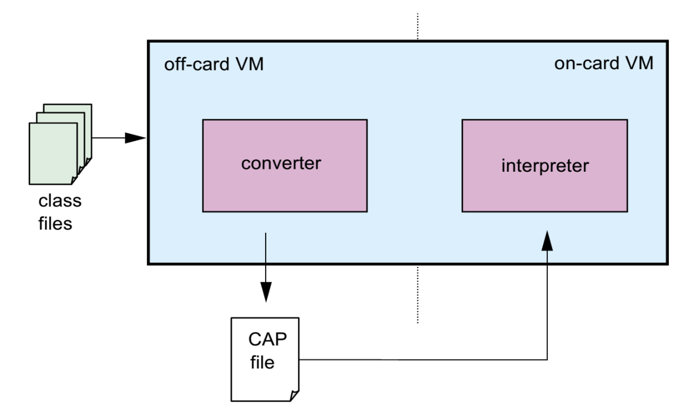

Chữ trong hình:

- off-card VM: converter
- on-card VM: interpreter
- class files → off-card VM (converter)
- converter → CAP file → interpreter

## Slide 9 · Bộ chuyển đổi Java Card

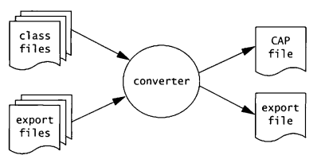

Chữ trong hình:

- class files, export files → converter
- converter → CAP file, export file

## Slide 10 · Trình thông dịch

***Trình thông dịch thực hiện các nhiệm vụ sau:***

- Thực hiện các hướng dẫn bytecode và cuối cùng thực thi các Applet
- Kiểm soát cấp phát bộ nhớ và tạo đối tượng
- Đóng một vai trò quan trọng trong việc đảm bảo an ninh thời gian thực thi

## Slide 11 · Trình cài đặt Java Card

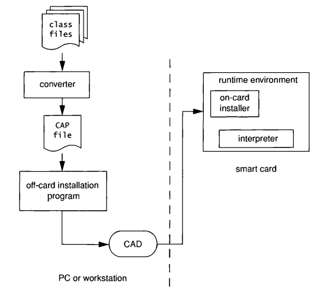

Chữ trong hình:

- PC or workstation: class files → converter → CAP file → off-card installation program → CAD
- CAD → runtime environment (qua đường nét đứt ngăn cách máy tính và thẻ)
- smart card: runtime environment, gồm on-card installer và interpreter

## Slide 12 · Các bước xây dựng ứng dụng Java Card

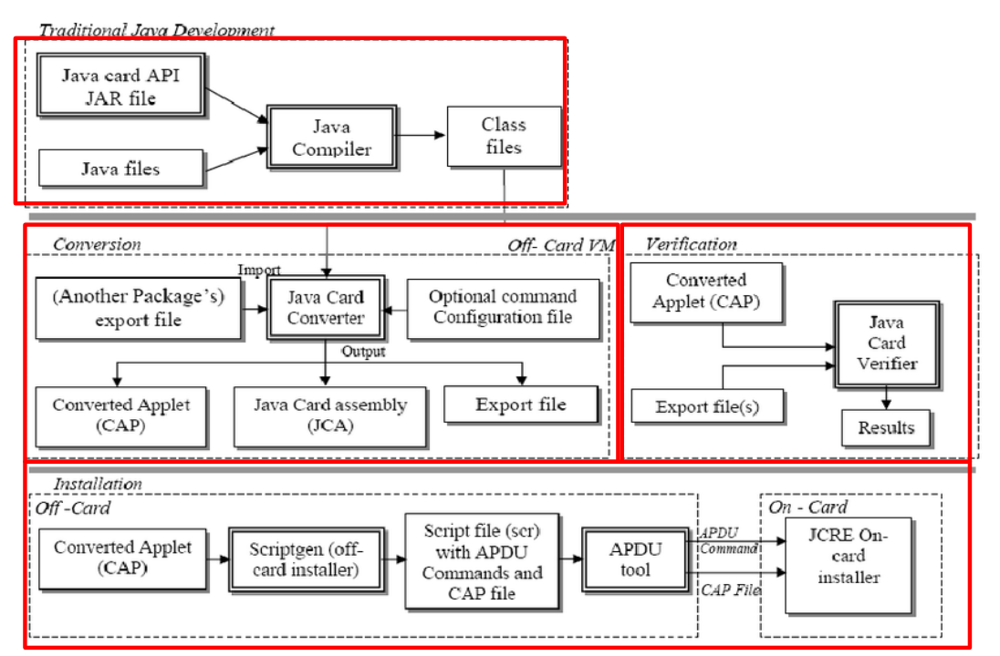

Chữ trong hình:

- Traditional Java Development: Java card API JAR file, Java files → Java Compiler → Class files
- Conversion (Off- Card VM): Class files, (Another Package’s) export file (nhãn Import), Optional command Configuration file → Java Card Converter → Output: Converted Applet (CAP), Java Card assembly (JCA), Export file
- Verification: Converted Applet (CAP), Export file(s) → Java Card Verifier → Results
- Installation:
  - Off -Card: Converted Applet (CAP) → Scriptgen (off-card installer) → Script file (scr) with APDU Commands and CAP file → APDU tool
  - APDU tool → On - Card: JCRE On-card installer (hai mũi tên: APDU Command, CAP File)

## Slide 13 · Môi trường thực thi Java Card (1)

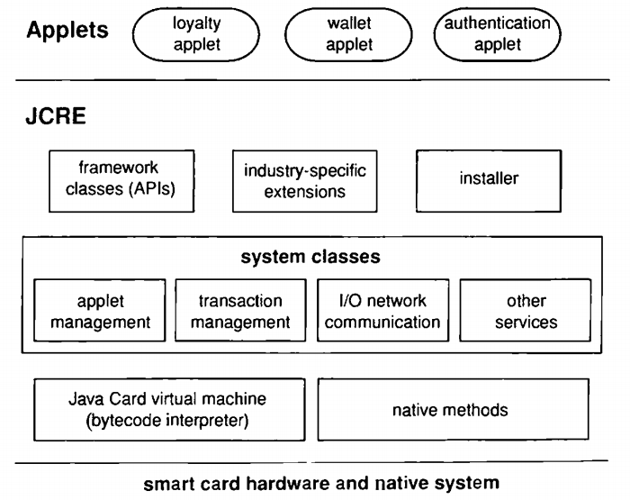

Chữ trong hình:

- Applets: loyalty applet, wallet applet, authentication applet
- JCRE:
  - framework classes (APIs), industry-specific extensions, installer
  - system classes: applet management, transaction management, I/O network communication, other services
  - Java Card virtual machine (bytecode interpreter), native methods
- smart card hardware and native system

## Slide 14 · Môi trường thực thi Java Card (2)

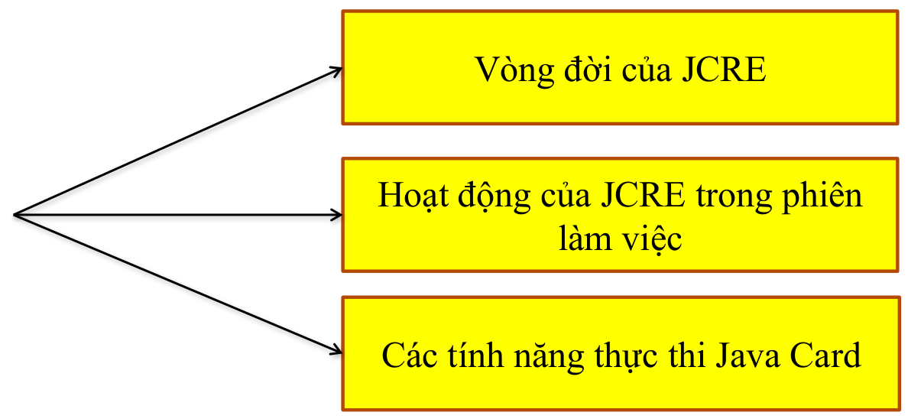

Chữ trong hình:

- Vòng đời của JCRE
- Hoạt động của JCRE trong phiên làm việc
- Các tính năng thực thi Java Card

## Slide 15 · Vòng đời của JCRE

- JCRE được khởi tạo tại thời điểm khởi tạo thẻ
- Tuổi thọ của JCRE tương đương với vòng đời của thẻ
- Khi mất điện máy ảo sẽ ngừng hoạt động và JCRE không khôi phục lại hoạt động của máy ảo khi có điện trở lại.

## Slide 16 · Hoạt động của JCRE trong phiên làm việc

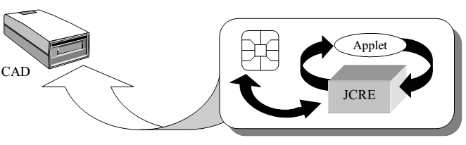

Chữ trong hình:

- CAD
- Applet, JCRE (trên thẻ; mũi tên vòng giữa Applet và JCRE, mũi tên hai chiều giữa chip và JCRE)
- Mũi tên lớn từ thẻ đến CAD

## Slide 17 · Các tính năng thực thi Java Card

***JCRE hỗ trợ ba tính năng thực thi bổ sung:***

- Các đối tượng liên tục và tạm thời
- Các hoạt động và giao dịch nguyên tử
- Tường lửa Applet và các cơ chế chia sẻ
