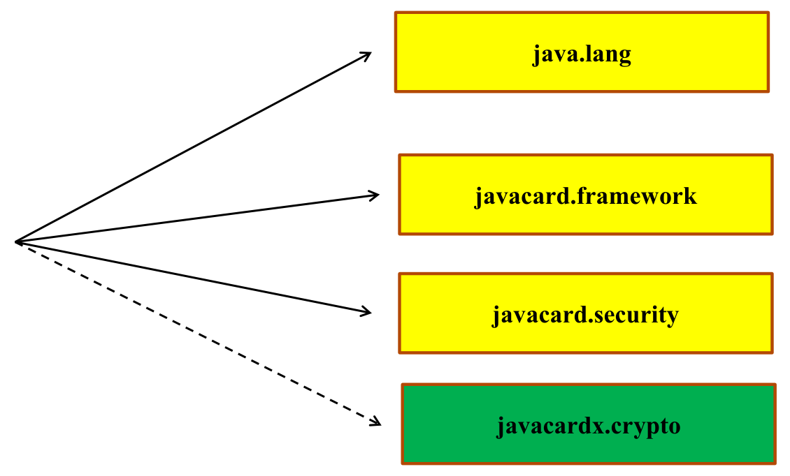
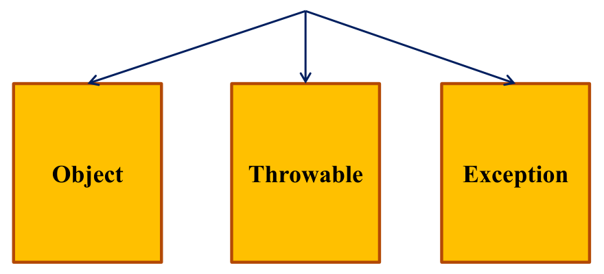

# Bài 3: Java Card API

> Nguồn: `142173273-1793637023484-bai4-javacardapis.pdf` · 24 slide · ThS. Cao Vinh, Khoa Công nghệ thông tin, Học viện Kỹ thuật Mật mã
> Chuyển từ PDF sang Markdown ngày 03/11/2026. Hình giữ dạng ảnh; chữ, mã và thông số trong hình được chép lại ngay dưới ảnh. Ghi chú của người chuyển đổi bắt đầu bằng "Ghi chú chuyển đổi".

> **Ghi chú chuyển đổi:** Trang bìa (và bookmark slide 1 của PDF) ghi “Bài 3: Java Card API”, còn tên tệp PDF là `142173273-1793637023484-bai4-javacardapis.pdf` (bài 4); tệp `631616381-1793636955951-bai3-gioithieuvengonngujavatrongjavacard.pdf` trong cùng bộ tài liệu cũng có trang bìa “Bài 3: …”. Tiêu đề được giữ đúng như in trên slide.

## Slide 1 · Trang bìa

- HỌC VIỆN KỸ THUẬT MẬT MÃ
- KHOA CÔNG NGHỆ THÔNG TIN
- Bài 3: Java Card API
- ThS. Cao Vinh
- caovinh226@gmail.com
- “Tri thức là chìa khóa mở cánh cửa tương lai"

## Slide 2 · Nội dung chính

1. Khái niệm API
2. Các gói APIs

## Slide 3 · Khái niệm APIs


Chữ trong hình:
- Your App
- API, với mũi tên REQUEST (Your App → Their App) và mũi tên DATA (Their App → Your App)
- Their App

## Slide 4 · Khái niệm Java Card API

Java Card API bao gồm một tập các class tùy chỉnh để lập trình các ứng dụng thẻ thông minh theo mô hình ISO 7816

## Slide 5 · API trong Java Card



Chữ trong hình:
- java.lang
- javacard.framework
- javacard.security
- javacardx.crypto (mũi tên nét đứt)

<https://docs.oracle.com/javacard/3.0.5/api/index.html>

## Slide 6 · Gói java.lang

***Ý nghĩa***

Gói java.lang của Java Card là một tập hợp con nghiêm ngặt của gói java.lang tương ứng trên nền tảng Java

Các lớp được hỗ trợ trong gói:



Chữ trong hình:
- Object
- Throwable
- Exception

## Slide 7 · Lớp Object

***Ý nghĩa***

Lớp Object là một siêu lớp, nó định nghĩa nguồn gốc cho tất cả các phân cấp lớp Java Card.

***Ví dụ***

```text
java.lang.Object
    java.lang.Throwable
        java.lang.Exception
            javacard.framework.CardException
```

- Phương thức của lớp Object:

  ```java
  public boolean equals(Object obj)
  ```

## Slide 8 · Lớp Throwable

***Ý nghĩa***

Lớp Throwable cung cấp hình thức cơ bản chung cho tất cả các ngoại lệ

```java
public class Throwable
extends Object
```

***Phương thức***

Kế thừa phương thức equals từ lớp Object.

## Slide 9 · Các lớp ngoại lệ (Exception)

***Ý nghĩa***

Các lớp ngoại lệ hỗ trợ đảm bảo ngữ nghĩa thống nhất khi xảy ra lỗi do vi phạm ngôn ngữ Java.

***Ví dụ***

```text
ArrayIndexOutOfBoundsException
NullPointerException
```

## Slide 10 · Gói javacard.framework

***Ý nghĩa***

Gói javacard.framework là một gói thiết yếu. Nó cung cấp các lớp khung và các giao diện cho các chức năng cốt lõi của một Applet Java Card.

Các lớp và giao diện chính trong gói javacard.framework:

- AID
- APDU
- Applet
- Lớp CardException và lớp CardRuntimeException
- ISO7816
- JCSystem.
- Shareable
- Util

## Slide 11 · Lớp AID

***Ý nghĩa***

Lớp này đóng gói mã định danh ứng dụng (AID) của một applet.

| Kiểu | Phương thức và mô tả |
|---|---|
| `boolean` | `equals(byte[] bArray, short offset, byte length)`<br>kiểm tra các byte AID trong bArray có giống trong đối tượng AID không. |
| `boolean` | `equals(Object anObject)`<br>so sánh các byte AID trong thực thể AID với các byte AID trong đối tượng anObject. |
| `byte` | `getBytes(byte[] dest, short offset)`<br>lấy ra các byte AID trong đối tượng AID. |
| `byte` | `getPartialBytes(short aidOffset, byte[] dest, short oOffset, byte oLength)`<br>lấy ra một phần các byte AID trong đối tượng AID với vị trí bắt đầu và độ dài được chỉ định. |
| `boolean` | `partialEquals(byte[] bArray, short offset, byte length)`<br>so sánh một phần các byte AID với length byte AID trong đối tượng AID. |
| `boolean` | `RIDEquals(AID otherAID)`<br>kiểm tra xem phần RID (số nhận dạng nhà cung cấp ứng dụng đã đăng ký quốc gia) của các byte AID được đóng gói trong đối tượng otherAID có khớp với đối tượng AID này không |

<https://docs.oracle.com/javacard/3.0.5/api/index.html>

## Slide 12 · Lớp APDU

***Ý nghĩa***

- Lớp này hỗ trợ cách thức làm việc với APDU.
- API của lớp APDU được thiết kế để độc lập với giao thức vận chuyển.

Nói cách khác, các Applet có thể sử dụng cùng các phương thức APDU bất kể giao thức cơ bản được sử dụng là T = 0 hay T = 1.

## Slide 13 · Lớp APDU

| Kiểu | Phương thức và mô tả |
|---|---|
| `byte[]` | `getBuffer()`<br>trả ra mảng byte bộ đệm APDU |
| `short` | `receiveBytes(short bOff)`<br>Nhận nhiều byte dữ liệu mà không bị tràn bộ đệm APDU, tại phần bù được chỉ định bOff. |
| `void` | `sendBytes(short bOff, short len)`<br>Gửi len bytes từ bộ đệm APDU bắt đầu từ phần bù được chỉ định bOff. |
| `void` | `sendBytesLong(byte[] outData, short bOff, short len)`<br>Gửi len byte từ mảng byte outData bắt đầu từ phần bù được chỉ định bOff. |
| `short` | `setIncomingAndReceive()`<br>Đây là phương thức nhận chính. |
| `short` | `setOutgoing()`<br>Phương pháp này được sử dụng để đặt hướng truyền dữ liệu ra bên ngoài và để có được độ dài phản hồi dự kiến (Ne). |
| `void` | `setOutgoingAndSend(short bOff, short len)`<br>Đạt hướng truyền dữ liệu ra bên ngoài và gửi len byte từ bộ đệm APDU |
| `void` | `setOutgoingLength(short len)`<br>đặt độ dài của dữ liệu phản hồi. |

## Slide 14 · Lớp Applet

***Ý nghĩa***

- Lớp Applet định nghĩa một Applet dựa trên công nghệ Java Card
- Bất kì Applet nào muốn tạo ra thì phải được mở rộng từ lớp Applet này

## Slide 15 · Lớp Applet

| Kiểu | Phương thức và mô tả |
|---|---|
| `public static void` | `install (byte[] bArray, short bOffset, byte bLength)`<br>JCRE gọi phương thức tĩnh này để tạo một thực thể của lớp con Applet |
| `protected final void` | `register ()`<br>Phương thức này được Applet sử dụng để đăng ký thực thể Applet này với JCRE và để gán AID mặc định trong file CAP cho thực thể Applet. |
| `protected final void` | `register (byte[] bArray, short bOffset, byte bLength)`<br>Phương thức này được Applet sử dụng để đăng ký thực thể Applet này với JCRE và để gán cho thực thể Applet AID được chỉ định trong mảng bArray. |
| `public boolean` | `select ()`<br>JCRE gọi phương thức này để thông báo cho Applet rằng nó đã được chọn |
| `public abstract void` | `process (APDU apdu)`<br>JCRE này gọi phương thức này để hướng dẫn Applet xử lý lệnh APDU đến |
| `public void` | `deselect ()`<br>JCRE gọi phương thức này để thông báo cho Applet hiện được chọn rằng Applet khác (hoặc tương tự) sẽ được chọn |

## Slide 16 · Lớp CardException và lớp CardRuntimeException

***Ý nghĩa***

- Lớp này hỗ trợ cách thức làm việc với các ngoại lệ.

| Kiểu | Phương thức và mô tả |
|---|---|
| `short` | `getReason()`<br>lấy mã lý do |
| `void` | `setReason(short reason)`<br>đặt mã lý do |
| `static void` | `throwIt(short reason)`<br>đưa ra một ngoại lệ với một mã lý do được chỉ định. |

## Slide 17 · Giao diện ISO7816

***Ý nghĩa***

ISO7816 đóng gói các hằng số liên quan đến ISO 7816-3 và ISO 7816-4.

***Mô tả chung:***

- Các trường tĩnh có tiền tố `SW_` xác định các hằng số cho từ trạng thái phản hồi được xác định theo tiêu chuẩn ISO 7816-4.
- Các trường sử dụng hậu tố `_00` yêu cầu byte thứ tự thấp được tùy chỉnh một cách thích hợp, ví dụ: (`ISO7816.SW_CORRECT_LENGTH_00`).
- Các trường tĩnh có tiền tố `OFFSET_` xác định các hằng số sẽ được sử dụng để lập chỉ mục vào mảng byte bộ đệm APDU để truy cập thông tin tiêu đề được xác định ISO 7816-4.

## Slide 18 · Lớp JCSystem

***Ý nghĩa***

- Lớp JCSystem bao gồm một tập hợp các phương thức để kiểm soát thực thi applet, quản lý tài nguyên, quản lý giao dịch nguyên tử, cơ chế xóa đối tượng và chia sẻ đối tượng giữa các applet trong môi trường Java Card.
- Lớp này cũng bao gồm các phương thức để kiểm soát tính liên tục và tạm thời của các đối tượng

## Slide 19 · Lớp JCSystem

***Các phương thức làm việc với giao dịch:***

| Kiểu | Phương thức và mô tả |
|---|---|
| `static void` | `abortTransaction()`<br>Hủy bỏ giao dịch nguyên tử |
| `static void` | `beginTransaction()`<br>Bắt đầu giao dịch nguyên tử. |
| `static void` | `commitTransaction()`<br>Hoàn thành giao dịch nguyên tử. |

## Slide 20 · Lớp JCSystem

***Các phương thức làm việc với đối tượng tạm thời***

| Kiểu | Phương thức và mô tả |
|---|---|
| `static boolean[]` | `makeTransientBooleanArray(short length, byte event)`<br>Tạo mảng tạm thời kiểu boolean với chiều dài được chỉ định trước. |
| `static byte[]` | `makeTransientByteArray(short length, byte event)`<br>Tạo mảng tạm thời kiểu byte với chiều dài được chỉ định trước. |
| `static Object[]` | `makeTransientObjectArray(short length, byte event)`<br>Tạo mảng tạm thời các Object với chiều dài được chỉ định trước. |
| `static short[]` | `makeTransientShortArray(short length, byte event)`<br>Tạo mảng tạm thời kiểu short với chiều dài được chỉ định trước. |

## Slide 21 · Giao diện Shareable

***Ý nghĩa và mô tả chung:***

- Giao diện Shareable phục vụ để xác định tất cả các đối tượng được chia sẻ.
- Bất kỳ đối tượng nào cần được chia sẻ thông qua tường lửa applet đều phải trực tiếp hoặc gián tiếp thực hiện giao diện này.
- Chỉ những phương thức được chỉ định trong giao diện có thể chia sẻ mới khả dụng qua tường lửa

***Ví dụ:***

```java
public interface masterInterface extends Shareable{
    public short getArray( byte[] array);
    public byte tinhDiem(byte diemToan, byte diemVan);
}
```

## Slide 22 · Lớp Util

***Ý nghĩa***

- Lớp này hỗ trợ cách thức làm việc với mảng, các biến.

| Kiểu | Phương thức và mô tả |
|---|---|
| `static byte` | `arrayCompare(byte[] src, short srcOff, byte[] dest, short destOff, short length)`<br>So sánh mảng nguồn src và mảng đích dest, bắt đầu từ vị trí đã được chỉ định (srcOff, destOff) với chiều dài length. |
| `static short` | `arrayCopy(byte[] src, short srcOff, byte[] dest, short destOff, short length)`<br>Sao chép một mảng từ mảng nguồn src, bắt đầu tại vị trí srcOff, đến vị trí destOff của mảng đích dest. |
| `static short` | `arrayCopyNonAtomic(byte[] src, short srcOff, byte[] dest, short destOff, short length)`<br>Sao chép một mảng từ mảng nguồn src, bắt đầu tại vị trí srcOff, đến vị trí destOff của mảng đích dest (không phải nguyên tử). |

## Slide 23 · Lớp Util

| Kiểu | Phương thức và mô tả |
|---|---|
| `static short` | `arrayFillNonAtomic(byte[] bArray, short bOff, short bLen, byte bValue)`<br>Điền vào mảng byte `bArray` (không phải nguyên tử) bắt đầu tại vị trí `bOff`, cho độ dài `bLen` với giá trị byte `bValue`. |
| `static short` | `getShort(byte[] bArray, short bOff)`<br>Nối hai byte trong một mảng byte `bArray` bắt đầu tại vị trí `bOff` để tạo thành một giá trị `short`. |
| `static short` | `makeShort(byte b1, byte b2)`<br>Nối hai byte `b1` và `b2` để tạo thành một giá trị `short`. |
| `static short` | `setShort(byte[] bArray, short bOff, short sValue)`<br>Gửi giá trị `short` dưới dạng hai byte liên tiếp bắt đầu từ vị trí `bOff` trong mảng byte `bArray`. |

## Slide 24 · Gói javacard.security và javacardx.crypto

***Ý nghĩa***

Các gói javacard.security và gói javacardx.crypto xác định các giao diện API mà Applet gọi để yêu cầu các dịch vụ mật mã.

Các dịch vụ mật mã:

- Mã hóa, giải mã
- Sinh khóa
- Băm dữ liệu
- Tạo dữ liệu ngẫu nhiên
- Ký số
- Trao đổi khóa
