# HƯỚNG DẪN CONNECT SMARTCARD SỬ DỤNG JAVA

> Nguồn: `731534458-1763475754060-huongdanketnoi.pdf` · 6 trang · Cao Vinh - CNTT
> Chuyển từ PDF sang Markdown ngày 03/11/2026. Hình giữ dạng ảnh; chữ, mã và thông số trong hình được chép lại ngay dưới ảnh. Ghi chú của người chuyển đổi bắt đầu bằng "Ghi chú chuyển đổi".

## Bước 1: Tạo project trên Java Card

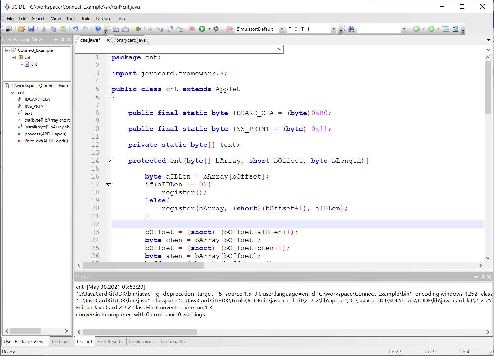

Mã trong hình:

```java
package cnt;

import javacard.framework.*;

public class cnt extends Applet
{

    public final static byte IDCARD_CLA = (byte)0xB0;

    public final static byte INS_PRINT = (byte) 0x11;

    private static byte[] text;

    protected cnt(byte[] bArray, short bOffset, byte bLength){

        byte aIDLen = bArray[bOffset];
        if(aIDLen == 0){
            register();
        }else{
            register(bArray, (short)(bOffset+1), aIDLen);
        }

        bOffset = (short) (bOffset+aIDLen+1);
        byte cLen = bArray[bOffset];
        bOffset = (short) (bOffset+cLen+1);
        byte aLen = bArray[bOffset];
```

(Ảnh hiển thị dòng 1–26 của `cnt.java`; dòng 27 bị cắt ở mép dưới khung soạn thảo.)

Thông tin trong hình:

- Tiêu đề cửa sổ: `JCIDE - C:\workspace\Connect_Example\src\cnt\cnt.java`
- Menu: `File`, `Edit`, `Search`, `View`, `Tool`, `Build`, `Debug`, `Help`
- Thanh công cụ: `Simulator:Default`, `T=0 | T=1`
- Tab soạn thảo: `cnt.java*` (đang mở), `librarycard.java`
- `User Package View`: project `Connect_Example`, gói `cnt`, tệp `cnt`
- Khung cấu trúc lớp (`C:\workspace\Connect_Examp…`, bị cắt): `cnt` gồm `IDCARD_CLA`, `INS_PRINT`, `text`, `cnt(byte[] bArray,short…`, `install(byte[] bArray,sho…`, `process(APDU apdu)`, `PrintText(APDU apdu)`
- Các tab phía dưới: `User Package View`, `Outline`; `Output`, `Find Results`, `Breakpoints`, `Bookmarks`
- Thanh trạng thái: `Ready`, `Ln 22`, `Col 9`, `Ch 4`

Khung `Output` (dòng 2 và dòng 3 bị cắt ở mép phải):

```text
cnt  [May 30,2021 03:53:29]
"C:\JavaCardKit\JDK\bin\javac" -g -deprecation -target 1.5 -source 1.5 -J-Duser.language=en -d "C:\workspace\Connect_Example\bin" -encoding windows-1252 -class
"C:\JavaCardKit\JDK\bin\java" -classpath "C:\JavaCardKit\SDK\Tools\JCIDE\lib\java_card_kit\2_2_2\lib\api.jar";"C:\JavaCardKit\SDK\Tools\JCIDE\lib\java_card_kit\2_2_2\
Feitian Java Card 2.2.2 Class File Converter, Version 1.3
conversion completed with 0 errors and 0 warnings.
```

***Chú ý:***

- Ở đây CLA của thẻ được định trước là B0
- 11 là INS của chức năng hiển thị giá trị được lưu trong thẻ

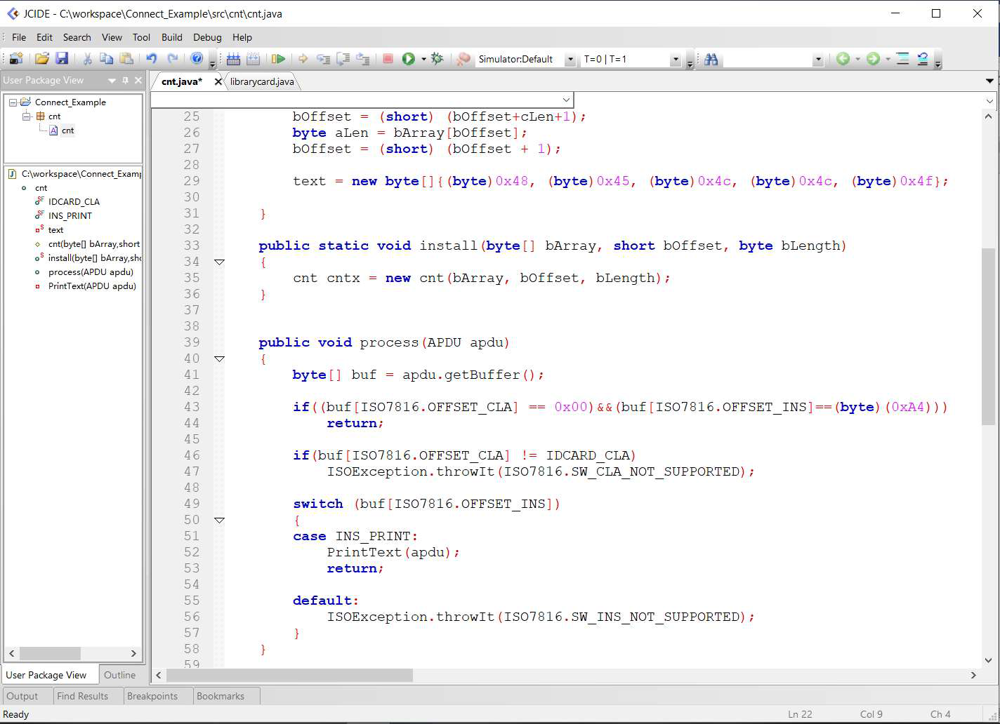

Mã trong hình:

```java
        bOffset = (short) (bOffset+cLen+1);
        byte aLen = bArray[bOffset];
        bOffset = (short) (bOffset + 1);

        text = new byte[]{(byte)0x48, (byte)0x45, (byte)0x4c, (byte)0x4c, (byte)0x4f};

    }

    public static void install(byte[] bArray, short bOffset, byte bLength)
    {
        cnt cntx = new cnt(bArray, bOffset, bLength);
    }


    public void process(APDU apdu)
    {
        byte[] buf = apdu.getBuffer();

        if((buf[ISO7816.OFFSET_CLA] == 0x00)&&(buf[ISO7816.OFFSET_INS]==(byte)(0xA4)))
            return;

        if(buf[ISO7816.OFFSET_CLA] != IDCARD_CLA)
            ISOException.throwIt(ISO7816.SW_CLA_NOT_SUPPORTED);

        switch (buf[ISO7816.OFFSET_INS])
        {
        case INS_PRINT:
            PrintText(apdu);
            return;

        default:
            ISOException.throwIt(ISO7816.SW_INS_NOT_SUPPORTED);
        }
    }
```

(Ảnh hiển thị dòng 25–58 của `cnt.java`; dòng 59 bị cắt ở mép dưới. Tài liệu không có ảnh phần còn lại của tệp, trong đó có thân hàm `PrintText(APDU apdu)`.)

Thông tin trong hình:

- Cùng cửa sổ `JCIDE - C:\workspace\Connect_Example\src\cnt\cnt.java`, thanh công cụ `Simulator:Default`, `T=0 | T=1`, tab `cnt.java*`, `librarycard.java`
- Khung Output đã thu gọn (chỉ còn các tab `Output`, `Find Results`, `Breakpoints`, `Bookmarks`); thanh trạng thái `Ready`, `Ln 22`, `Col 9`, `Ch 4`

## Bước 2: Tạo Project trên Netbean IDE

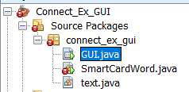

Thông tin trong hình (cây project, tệp `GUI.java` đang được chọn):

```text
Connect_Ex_GUI
  Source Packages
    connect_ex_gui
      GUI.java
      SmartCardWord.java
      text.java
```

- GUI.java: Giao diện thực thi các chức năng
- SmartCardWord.java: Chứa các hàm dùng cho việc giao tiếp với thẻ
- text.java: modul (có thể không cần)

## Bước 3: Thiết kế giao diện

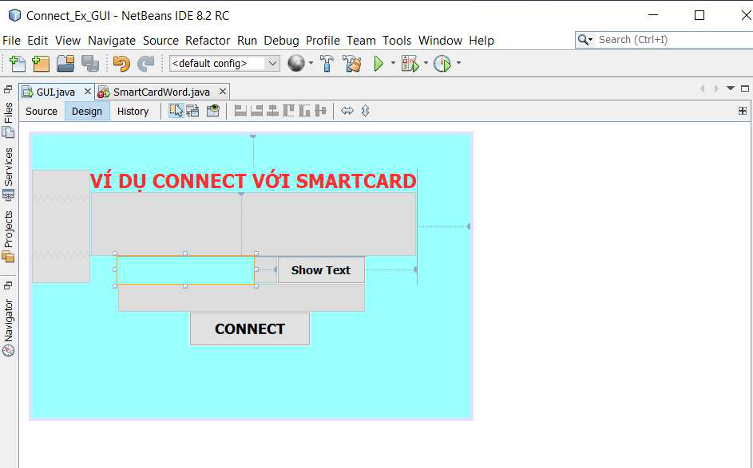

Thông tin trong hình:

- Tiêu đề cửa sổ: `Connect_Ex_GUI - NetBeans IDE 8.2 RC`
- Menu: `File`, `Edit`, `View`, `Navigate`, `Source`, `Refactor`, `Run`, `Debug`, `Profile`, `Team`, `Tools`, `Window`, `Help`; ô tìm kiếm `Search (Ctrl+I)`; cấu hình `<default config>`
- Tab: `GUI.java` (đang mở), `SmartCardWord.java`; chế độ xem `Source`, `Design` (đang chọn), `History`
- Thanh dọc bên trái: `Files`, `Services`, `Projects`, `Navigator`
- Form (nền xanh nhạt): nhãn `VÍ DỤ CONNECT VỚI SMARTCARD` (chữ đỏ), một ô nhập văn bản (đang được chọn), nút `Show Text`, nút `CONNECT`, cùng vài thành phần trống màu xám

## Bước 4: Lập trình các hàm để connect với thẻ

- **Các thư viện sử dụng:**

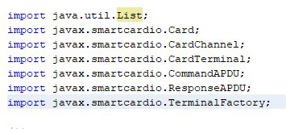

Mã trong hình:

```java
import java.util.List;
import javax.smartcardio.Card;
import javax.smartcardio.CardChannel;
import javax.smartcardio.CardTerminal;
import javax.smartcardio.CommandAPDU;
import javax.smartcardio.ResponseAPDU;
import javax.smartcardio.TerminalFactory;
```

(Dòng kế tiếp ở mép dưới ảnh bị cắt, không đọc được.)

- **Chức năng Connect với thẻ**

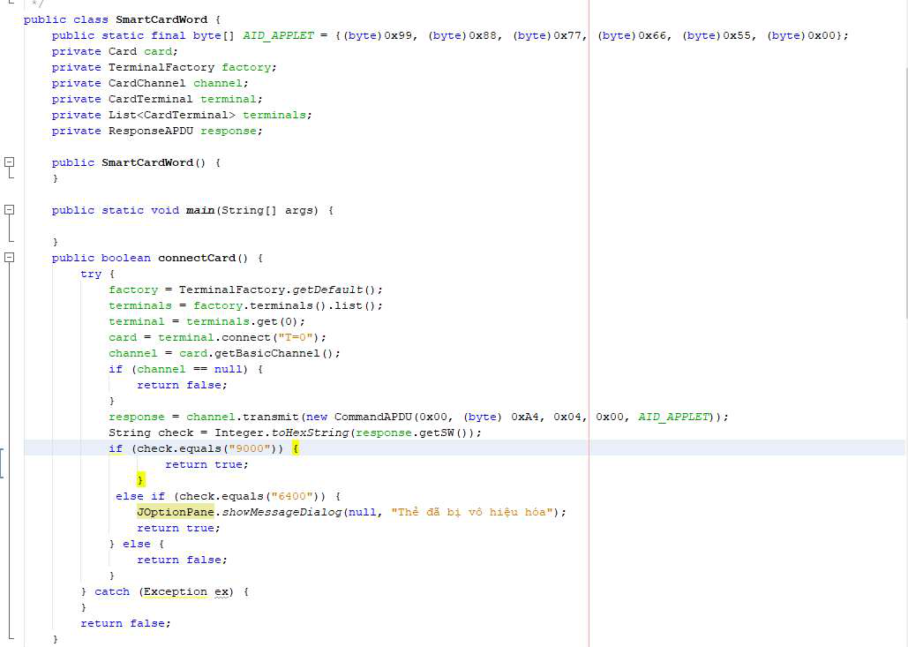

Mã trong hình:

```java
 */
public class SmartCardWord {
    public static final byte[] AID_APPLET = {(byte)0x99, (byte)0x88, (byte)0x77, (byte)0x66, (byte)0x55, (byte)0x00};
    private Card card;
    private TerminalFactory factory;
    private CardChannel channel;
    private CardTerminal terminal;
    private List<CardTerminal> terminals;
    private ResponseAPDU response;

    public SmartCardWord() {
    }

    public static void main(String[] args) {

    }
    public boolean connectCard() {
        try {
            factory = TerminalFactory.getDefault();
            terminals = factory.terminals().list();
            terminal = terminals.get(0);
            card = terminal.connect("T=0");
            channel = card.getBasicChannel();
            if (channel == null) {
                return false;
            }
            response = channel.transmit(new CommandAPDU(0x00, (byte) 0xA4, 0x04, 0x00, AID_APPLET));
            String check = Integer.toHexString(response.getSW());
            if (check.equals("9000")) {
                    return true;
                }
             else if (check.equals("6400")) {
                JOptionPane.showMessageDialog(null, "Thẻ đã bị vô hiệu hóa");
                return true;
            } else {
                return false;
            }
        } catch (Exception ex) {
        }
        return false;
    }
```

(Dòng đầu `*/` bị cắt một nửa ở mép trên ảnh.)

Sau khi connect với thẻ

`card = terminal.connect(“T=0”)`

ta gửi APDU lệnh để chọn Applet. Cấu trúc của APDU lệnh như sau:

| CLA | INS | P1 | P2 | Lc | Data |
|---|---|---|---|---|---|
| 00 | A4 | 04 | 00 | AID_len | AID_APPLET |

Khi gửi lệnh này, trên JCIDE tương ứng với lệnh:

`/select AID_APPLET`

Nếu thẻ trả về APDU phản hồi:

90 00 → connect thành công

6400 → thẻ bị vô hiệu hóa

**Chú ý:**

AID_APPLET là AID mà Applet đã đăng ký với JCRE

- **Chức năng Disconnect với thẻ**

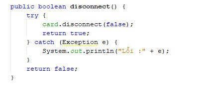

Mã trong hình:

```java
public boolean disconnect() {
    try {
        card.disconnect(false);
        return true;
    } catch (Exception e) {
        System.out.println("Lỗi :" + e);
    }
    return false;
}
```

## Bước 5: Quay lại với giao diện để set các button

- **BUTTON CONNECT:** Đây là button thực hiện việc kết nối với Smart Card.
  - Đầu tiên, button sẽ check xem thẻ đã được connect chưa.
  - Nếu chưa được connect, thực thi lệnh connectCard được gọi từ SmartCardWork.java.

    Nếu giá trị trả về là “true” => Connect thành công

    Nếu giá trị trả về là “false” => Chưa connect được đến Applet

  - Nếu đã được kết nối, button sẽ gửi lệnh disconnect

> **Ghi chú chuyển đổi:** Ở đây bản gốc ghi `SmartCardWork.java`, còn ở Bước 2 và trong mọi ảnh chụp (cây project, tab NetBeans, mã `public class SmartCardWord`) tên tệp là `SmartCardWord.java`.

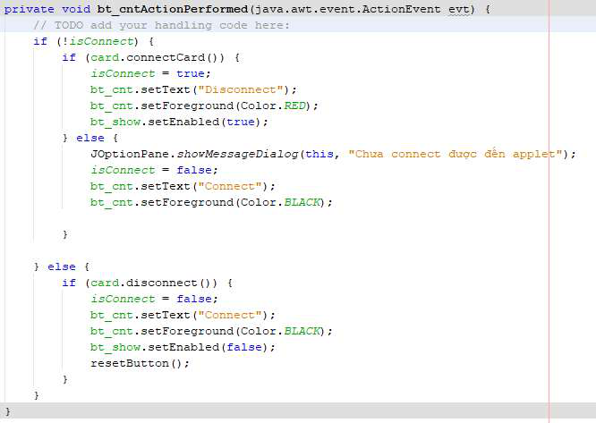

Mã trong hình:

```java
private void bt_cntActionPerformed(java.awt.event.ActionEvent evt) {
    // TODO add your handling code here:
    if (!isConnect) {
        if (card.connectCard()) {
            isConnect = true;
            bt_cnt.setText("Disconnect");
            bt_cnt.setForeground(Color.RED);
            bt_show.setEnabled(true);
        } else {
            JOptionPane.showMessageDialog(this, "Chưa connect được đến applet");
            isConnect = false;
            bt_cnt.setText("Connect");
            bt_cnt.setForeground(Color.BLACK);

        }

    } else {
        if (card.disconnect()) {
            isConnect = false;
            bt_cnt.setText("Connect");
            bt_cnt.setForeground(Color.BLACK);
            bt_show.setEnabled(false);
            resetButton();
        }
    }
}
```

## Bước 6: Thực nghiệm

1. Run máy ảo của SmartCard

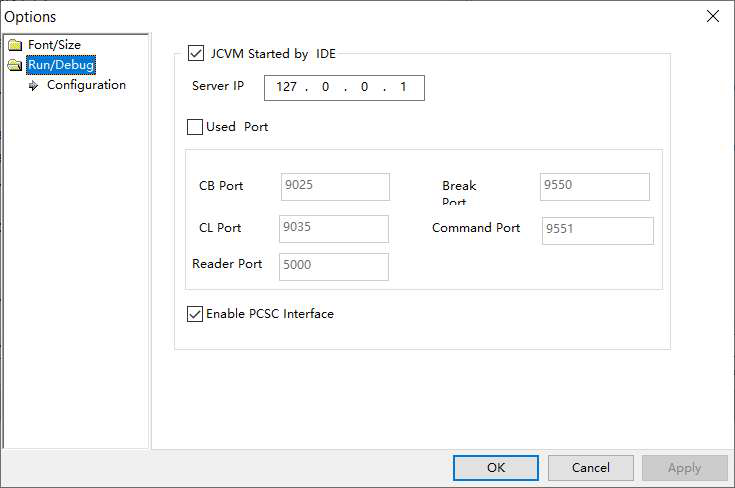

Thông tin trong hình:

- Hộp thoại `Options`; cây bên trái: `Font/Size`, `Run/Debug` (đang chọn), mục con `Configuration`
- `JCVM Started by  IDE`: đã đánh dấu
- `Server IP`: `127 . 0 . 0 . 1`
- `Used  Port`: không đánh dấu; các ô cổng bên dưới bị mờ: `CB Port` `9025`, `Break Port` `9550`, `CL Port` `9035`, `Command Port` `9551`, `Reader Port` `5000`
- `Enable PCSC Interface`: đã đánh dấu
- Nút `OK`, `Cancel`, `Apply` (mờ)

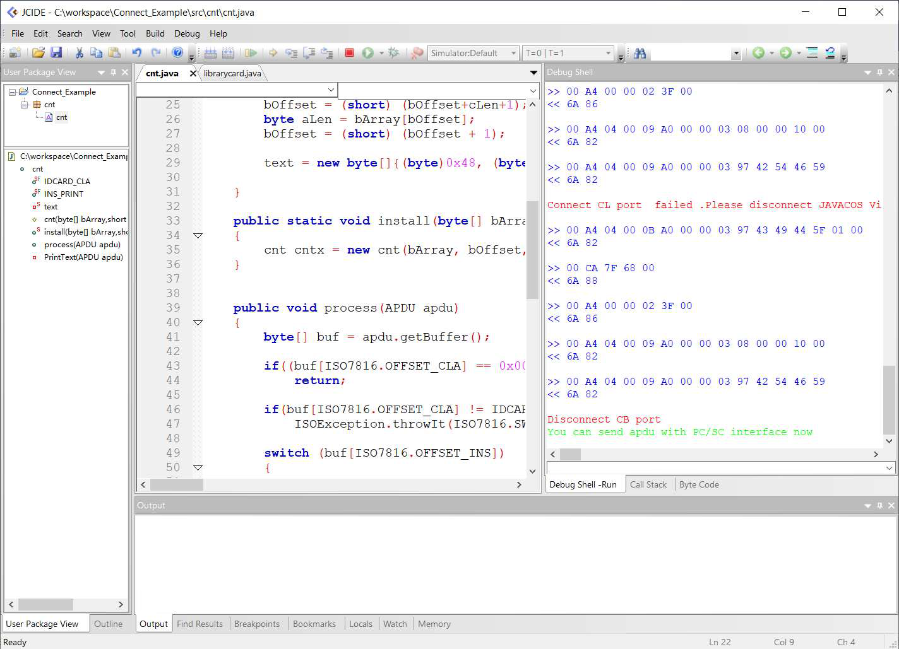

Thông tin trong hình:

- Cửa sổ `JCIDE - C:\workspace\Connect_Example\src\cnt\cnt.java`; máy ảo đang chạy (nút dừng màu đỏ sáng, ô `Simulator:Default` và `T=0 | T=1` bị mờ)
- Khung soạn thảo: tab `cnt.java`, `librarycard.java`; hiển thị dòng 25–50 của `cnt.java` (cùng mã như hình thứ hai ở Bước 1, phần bên phải bị che)
- Khung `Output` trống; các tab `Output`, `Find Results`, `Breakpoints`, `Bookmarks`, `Locals`, `Watch`, `Memory`; thanh trạng thái `Ready`, `Ln 22`, `Col 9`, `Ch 4`

Khung `Debug Shell` (tab `Debug Shell -Run`, bên cạnh `Call Stack`, `Byte Code`; dòng chữ đỏ đầu tiên bị cắt ở mép phải):

```text
>> 00 A4 00 00 02 3F 00
<< 6A 86

>> 00 A4 04 00 09 A0 00 00 03 08 00 00 10 00
<< 6A 82

>> 00 A4 04 00 09 A0 00 00 03 97 42 54 46 59
<< 6A 82

Connect CL port  failed .Please disconnect JAVACOS Vi

>> 00 A4 04 00 0B A0 00 00 03 97 43 49 44 5F 01 00
<< 6A 82

>> 00 CA 7F 68 00
<< 6A 88

>> 00 A4 00 00 02 3F 00
<< 6A 86

>> 00 A4 04 00 09 A0 00 00 03 08 00 00 10 00
<< 6A 82

>> 00 A4 04 00 09 A0 00 00 03 97 42 54 46 59
<< 6A 82

Disconnect CB port
You can send apdu with PC/SC interface now
```

2. Run chương trình giao tiếp với thẻ trên NetBean (Shift + F6)

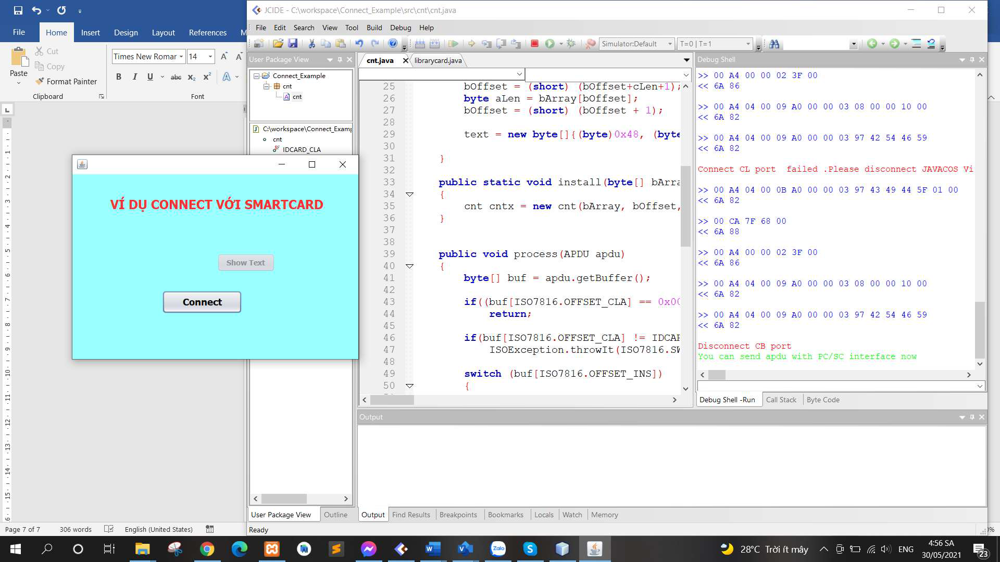

Thông tin trong hình:

- Cửa sổ chương trình Java (biểu tượng Java, không có tiêu đề), nền xanh nhạt: nhãn `VÍ DỤ CONNECT VỚI SMARTCARD`, nút `Show Text` (mờ), nút `Connect`
- Cửa sổ `JCIDE - C:\workspace\Connect_Example\src\cnt\cnt.java`: khung soạn thảo dòng 25–50 của `cnt.java`; khung `Debug Shell` có cùng nội dung như hình ở mục 1 (từ `>> 00 A4 00 00 02 3F 00` đến `You can send apdu with PC/SC interface now`)
- Phía sau là Microsoft Word (thanh trạng thái `Page 7 of 7`, `306 words`, `English (United States)`); thanh tác vụ Windows: `28°C Trời ít mây`, `ENG`, `4:56 SA`, `30/05/2021`

3. Nhấp vào nút Connect, quan sát trong Debug Shell của JCIDE

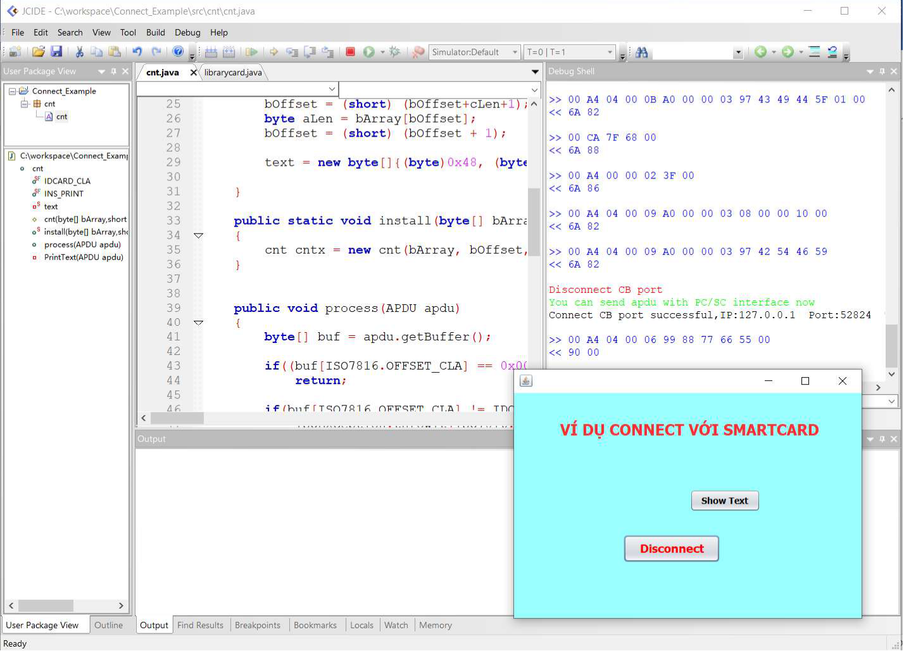

Thông tin trong hình:

- Cửa sổ `JCIDE - C:\workspace\Connect_Example\src\cnt\cnt.java` (khung soạn thảo dòng 25–46 của `cnt.java`); cửa sổ chương trình Java nằm đè lên góc dưới bên phải
- Chương trình Java: nhãn `VÍ DỤ CONNECT VỚI SMARTCARD`, nút `Show Text` (đã bật), nút `Disconnect` (chữ đỏ)

Khung `Debug Shell` (đã cuộn xuống; phần dưới bị cửa sổ chương trình Java che):

```text
>> 00 A4 04 00 0B A0 00 00 03 97 43 49 44 5F 01 00
<< 6A 82

>> 00 CA 7F 68 00
<< 6A 88

>> 00 A4 00 00 02 3F 00
<< 6A 86

>> 00 A4 04 00 09 A0 00 00 03 08 00 00 10 00
<< 6A 82

>> 00 A4 04 00 09 A0 00 00 03 97 42 54 46 59
<< 6A 82

Disconnect CB port
You can send apdu with PC/SC interface now
Connect CB port successful,IP:127.0.0.1  Port:52824

>> 00 A4 04 00 06 99 88 77 66 55 00
<< 90 00
```

→Thẻ đã connect được thành công
