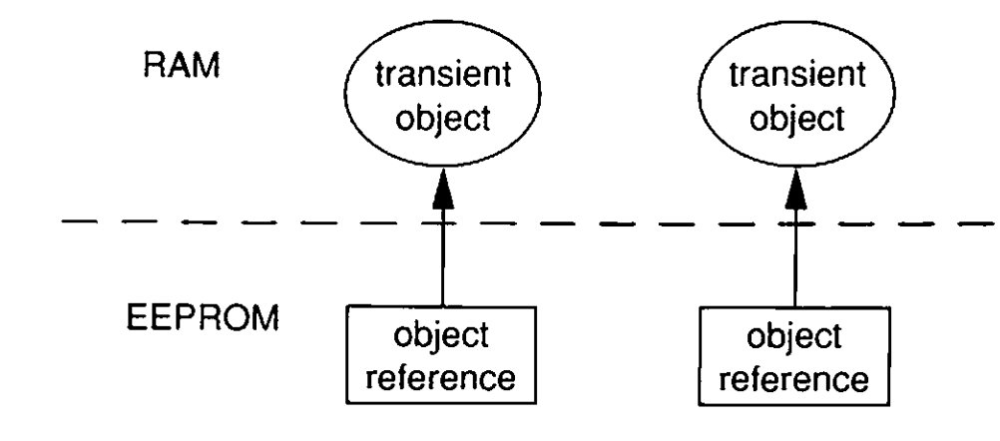
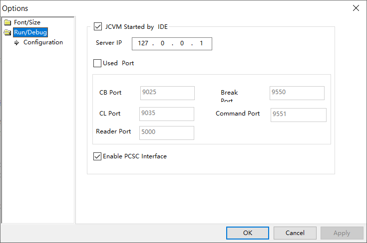
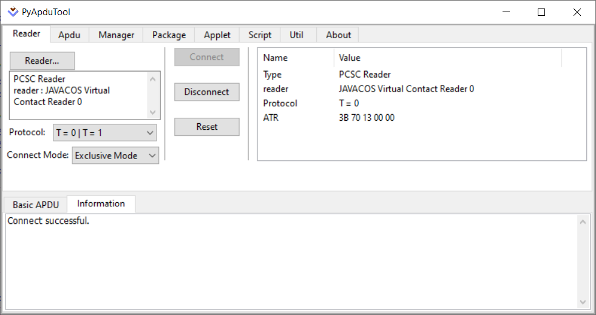
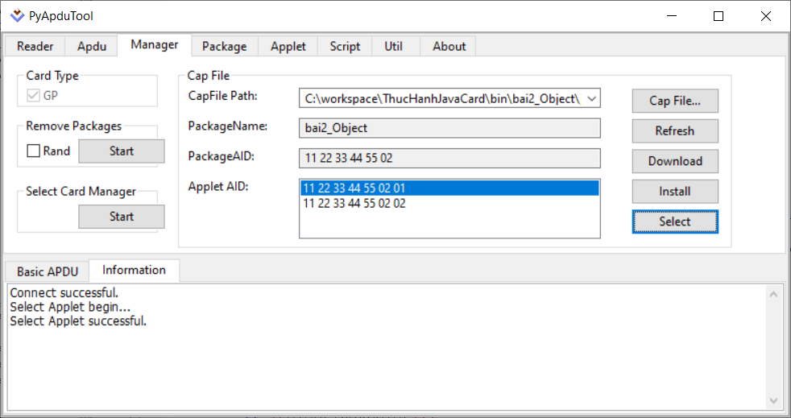
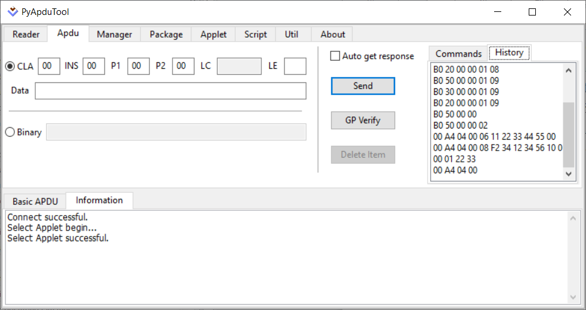

# BÀI THỰC HÀNH SỐ 2 CÁC ĐỐI TƯỢNG TRONG JAVA CARD

> Nguồn: `174805662-1762695260031-baithuchanhso2-cacdoituongtrongjavacard.pdf` · 12 trang · Cao Vinh - CNTT
> Chuyển từ PDF sang Markdown ngày 03/11/2026. Hình giữ dạng ảnh; chữ, mã và thông số trong hình được chép lại ngay dưới ảnh. Ghi chú của người chuyển đổi bắt đầu bằng "Ghi chú chuyển đổi".

## 2.1 Đối tượng tồn tại liên tục

Bộ nhớ và dữ liệu của các đối tượng tồn tại liên tục được lưu trữ trong các phiên của CAD. Một đối tượng tồn tại liên tục có những thuộc tính sau:

- Một đối tượng tồn tại liên tục được tạo bởi một toán tử `new`.
- Một đối tượng tồn tại liên tục giữ các trạng thái và giá trị trong các phiên của CAD.
- Bất kì một cập nhật nào cho một trường đơn trong đối tượng tồn tại liên tục đều là nguyên tử. Điều đó có nghĩa là nếu thẻ bị mất nguồn hoặc xảy ra lỗi trong quá trình cập nhật thì trường được khôi phục về giá trị trước đó.
- Một đối tượng tồn tại liên tục có thể được tham chiếu bởi một trường trong một đối tượng tạm thời.
- Một trường trong đối tượng tồn tại liên tục có thể tham chiếu tới một đối tượng tạm thời.
- Nếu một đối tượng tồn tại liên tục không được tham chiếu bởi một đối tượng khác, nó sẽ không thể truy cập hoặc khôi phục được.

Khi một cá thể Applet được tạo, giống như bất kì một đối tượng liên tục nào khác, không gian và dữ liệu của Applet vẫn tồn tại vô thời hạn từ phiên CAD này sang phiên tiếp theo.

Theo mặc định, các đối tượng Java Card là liên tục và được tạo trong bộ nhớ liên tục. Không gian và dữ liệu của các đối tượng như vậy trải dài trên các phiên CAD. Vì lý do bảo mật và hiệu suất, các Applet có thể tạo các đối tượng trong RAM. Những đối tượng như vậy được gọi là đối tượng tạm thời. Các đối tượng tạm thời chứa dữ liệu tạm thời, chúng không liên tục trong các phiên CAD.

## 2.2 Các đối tượng tạm thời

Thuật ngữ “đối tượng tạm thời” là một cách gọi chưa thực sự chính xác. Nó có thể được hiểu một cách không chính xác rằng bản thân các đối tượng đó là tạm thời, nghĩa là khi bị mất điện, đối tượng tạm thời bị phá hủy. Tuy nhiên, trong thực tế, thuật ngữ đối tượng tạm thời có nghĩa là nội dung của các trường trong đối tượng đó có bản chất tạm thời. Cũng giống như các đối tượng tồn tại liên tục, không gian được phân bổ cho các đối tượng tạm thời được dành riêng và không được thu hồi trừ khi thực hiện quá trình thu gom rác.

Một Applet tạo nên một đối tượng tạm thời chỉ một lần duy nhất trong suốt vòng đời của nó và lưu đối tượng tham chiếu trong một trường liên tục, như hình Hình 2.1. Ở các lần tiếp theo khi thẻ được bật lên, Applet sẽ sử dụng đối tượng tham chiếu này để kết nối với đối tượng tạm thời, mặc cho dữ liệu của đối tượng từ phiên trước đã bị mất.



*Hình 2.1 Đối tượng tạm thời*

Chữ trong hình:
- RAM (phía trên đường nét đứt): transient object, transient object
- EEPROM (phía dưới đường nét đứt): object reference, object reference
- Mũi tên: object reference → transient object (hai cặp)

### 2.2.1 Đặc điểm của đối tượng tạm thời

Trong Java Card, chỉ những mảng có kiểu cơ bản hoặc mảng tham chiếu tới đối tượng thì mới có thể khai báo tạm thời. Kiểu cơ bản trong nền tảng Java Card là `byte`, `short`, `int` và `boolean`. Xuyên suốt giáo trình này, thuật ngữ đối tượng tạm thời và mảng tồn tại tạm thời được sử dụng hoán đổi cho nhau. Đối tượng tạm thời trong nền tảng Java Card có một số đặc điểm như sau:

- Một đối tượng tạm thời được tạo ra bằng cách gọi API của Java Card.
- Một đối tượng tạm thời không giữ các trạng thái và giá trị trong các phiên CAD. Vào thời điểm xảy ra một số sự kiện nhất định, các trường của một đối tượng tạm thời được xóa thành giá trị mặc định của chúng (`zero`, `false` hoặc `null`).
- Bất kì một cập nhật nào cho một trường đơn trong đối tượng tồn tại liên tục đều là không nguyên tử. Điều đó có nghĩa là, nếu thẻ bị mất nguồn hoặc xảy ra lỗi trong quá trình cập nhật thì trường không được khôi phục về giá trị trước đó. Nếu ghi vào các trường của các đối tượng tạm thời trong một giao dịch, khi giao dịch bị hủy bỏ sẽ không làm cho một trường trong đối tượng tạm thời được khôi phục về giá trị trước đó.

> **Ghi chú chuyển đổi:** Gạch đầu dòng trên thuộc danh sách đặc điểm của đối tượng tạm thời nhưng câu đầu in “đối tượng tồn tại liên tục”; mục 2.1 nêu cập nhật trường của đối tượng tồn tại liên tục là nguyên tử.

- Một đối tượng tạm thời có thể được tham chiếu bởi một trường trong đối tượng tồn tại liên tục.
- Một trường trong đối tượng tạm thời có thể tham chiếu tới đối tượng tồn tại liên tục.
- Nếu một đối tượng tạm thời không được được tham chiếu bởi một đối tượng khác, nó sẽ không thể truy cập hoặc nhận giá trị rác.
- Việc ghi vào trường của một dữ liệu tạm thời sẽ không gây ảnh hưởng đến hiệu năng vì RAM có chu kỳ ghi nhanh hơn rất nhiều so với EEPROM

Các đặc điểm của các đối tượng tạm thời làm cho chúng trở nên lý tưởng cho một lượng nhỏ dữ liệu của Applet tạm thời, cái mà thường xuyên được sửa đổi nhưng không cần phải lưu giữ trong các phiên CAD. Nhà phát triển Applet cần đảm bảo rằng dữ liệu tạm thời như vậy được lưu trữ trong các mảng tạm thời. Điều này giúp giảm hao mòn tiềm năng trong bộ nhớ liên tục, đảm bảo hiệu suất ghi tốt hơn và thêm cả phần bảo mật để bảo vệ các dữ liệu nhạy cảm. Theo nguyên tắc thông thường, nếu dữ liệu tạm thời được cập nhật nhiều lần cho mỗi APDU được xử lý, nhà phát triển Applet nên chuyển chúng thành mảng tạm thời.

### 2.2.2 Các dạng đối tượng tạm thời

Có hai đối tượng tạm thời là `CLEAR_ON_RESET` và `CLEAR_ON_DESELECT`. Một trong hai loại đối tượng tạm thời được liên kết với sự kiện, trong đó nếu sự kiện xảy ra thì sẽ làm cho JCRE xóa các trường của đối tượng.

Các đối tượng tạm thời `CLEAR_ON_RESET` được sử dụng để duy trì dữ liệu cần được lưu trữ trên Applet nhưng không phải trên toàn bộ thẻ. Ví dụ: khóa phiên chính của thẻ phải được khai báo là loại `CLEAR_ON_RESET` để có thể chia sẻ khóa phiên tương tự giữa các Applet được chọn trong một phiên CAD. Khi thẻ được cài đặt lại, các trường của các đối tượng tạm thời `CLEAR_ON_RESET` sẽ bị xóa. Việc cài đặt lại thẻ có thể được thực hiện bởi tín hiệu cài đặt lại gửi đến mạch thẻ (warm reset) hoặc bằng cách tắt và bật lại nguồn điện.

Các đối tượng tạm thời `CLEAR_ON_DESELECT` được sử dụng để duy trì dữ liệu cần được lưu trữ khi một Applet được chọn và sẽ mất đi khi Applet không được chọn hay reset lại thẻ. Ví dụ: Khóa phiên ứng với đối tượng Applet cần được khai báo là kiểu `CLEAR_ON_DESELECT`. Khi đối tượng Applet bị bỏ chọn, khóa phiên sẽ tự động xóa bởi JCRE. Đây là sự phòng ngừa bảo mật để đối tượng Applet khác không thể đọc được dữ liệu khóa phiên hoặc mạo danh là đối tượng chứa khóa đấy.

Thiết lập lại thẻ là ngầm loại bỏ tất cả các lựa chọn hiện hành của Applet. Do đó các trường của đối tượng `CLEAR_ON_DESELECT` cũng bị xóa bởi cùng các sự kiện được chỉ định cho `CLEAR_ON_RESET`. Hay nói cách khác là đối tượng `CLEAR_ON_DESELECT` cũng giống như đối tượng `CLEAR_ON_RESET`. Thêm vào đó, các đối tượng tạm thời `CLEAR_ON_DESELECT` có các đặc điểm bổ sung của tường lửa Applet.

### 2.2.3 Tạo các đối tượng tạm thời

Trong công nghệ Java Card, các đối tượng tạm thời được tạo ra bằng cách sử dụng một trong các phương thức xuất xưởng trong lớp `JCSystem`, như trong Bảng 2.1.

*Bảng 2.1 Các phương thức để tạo nên các mảng tạm thời trong class `JCSystem`*

| Phương thức | Kết quả |
| --- | --- |
| `public static boolean[] makeTransientBooleanArray(short length, byte event)` | Tạo ra một mảng `boolean` tạm thời |
| `public static byte[] makeTransientByteArray(short length, byte event)` | Tạo ra một mảng `byte` tạm thời |
| `public static short[] makeTransientShortArray(short length, byte event)` | Tạo ra một mảng `short` tạm thời |
| `public static object [] makeTransientObjectArray(short length, byte event)` | Tạo ra một mảng `object` tạm thời |

> **Ghi chú chuyển đổi:** Hàng cuối của bảng in kiểu trả về là `object []` (chữ thường); trong Java tên lớp là `Object`, phương thức `makeTransientObjectArray` trả về `Object[]`.

Tham số đầu tiên: `length` trong mỗi lời gọi phương thức chỉ rõ lời độ dài yêu cầu của mảng tạm thời. Tham số thứ hai: `event`, chỉ rõ loại sự kiện sẽ bị xóa của đối tượng. Do đó nó chỉ định loại mảng tạm thời, hoặc là `CLEAR_ON_RESET` hoặc là `CLEAR_ON_DESELECT`. Hai hằng số trong lớp `JCSystem` đều được sử dụng để diễn đạt loại mảng tạm thời:

```java
// dạng CLEAR_ON_RESET của mảng tạm thời
public static final byte CLEAR_ON_RESET
// loại CLEAR_ON_DESELECT của mảng tạm thời
public static final byte CLEAR_ON_DESELECT
```

Đoạn mã sau đây tạo ra mảng loại `CLEAR_ON_DESELECT`

```java
byte[] buffer =
JCSystem.makeTransientByteArray (BUFFER_LENGTH,
JCSystem.CLEAR_ON_DESELECT);
```

### 2.2.4 Truy vấn các đối tượng tạm thời

Một Applet có thể truy cập vào một đối tượng có thể được tạo ra bởi một Applet khác. Lớp `JCSystem` cung cấp một phương thức truy vấn thuận tiện cho một Applet để xác định xem đối tượng đang được truy cập có phải là tạm thời hay không:

```java
public static byte isTransient(Object theObject)
```

Phương thức `isTransient` trả về dạng hằng số tạm thời (có thể là `CLEAR_ON_RESET` hoặc `CLEAR_ON_DESELECT`) hoặc là hằng số `JCSystem.NOT_A_TRANSIENT_OBJECT` để chỉ ra đối tượng là `null` hay là một đối tượng liên tục.

## 2.3 Ví dụ

Để hiểu rõ hơn về bản chất của đối tượng liên tục và đối tượng tạm thời, chúng ta xem xét ví dụ sau: giả sử chúng ta có một Applet trong đó có biến sử dụng biến toàn cục `x`, đối tượng tồn tại liên tục `buffer` và đối tượng tồn tại tạm thời `buffer1` và `buffer2` (`buffer1` là đối tượng tạm thời dạng `CLEAR_ON_DESELECT`, `buffer2` là đối tượng tạm thời dạng `CLEAR_ON_RESET`). Trong Applet sử dụng 2 lệnh INS là: `INS_UPDATE` dùng để cập nhật dữ liệu cho các đối tượng và biến, `INS_SEND` dùng để gửi giá trị của các đối tượng và biến lên máy chủ (giá trị được gửi lên máy chủ theo thứ tự: giá trị của biến `x` → giá trị `buffer` → giá trị của `buffer1` → giá trị của `buffer2`).

Kết quả chúng ta có được một Applet như sau:

```java
package bai2_Object;

import javacard.framework.*;

public class Applet1 extends Applet
{
    //khai bao cac doi tuong va bien
    private static byte[] buffer, buffer1, buffer2;
    private byte x;

    // khai bao ma INS trong tieu de cua apdu
    final static byte INS_SEND         = (byte)0x00;
    final static byte INS_UPDATE  = (byte)0x01;

    public static void install(byte[] bArray, short bOffset, byte bLength)
    {
        new Applet1().register(bArray, (short) (bOffset + 1), bArray[bOffset]);
        //khoi tao doi tuong lien tuc
        buffer = new byte [2];
        //khoi tao doi tuong tam thoi
        buffer1 = JCSystem.makeTransientByteArray ((short)2, JCSystem.CLEAR_ON_DESELECT);
        buffer2 = JCSystem.makeTransientByteArray ((short)2, JCSystem.CLEAR_ON_RESET);
    }

    public void process(APDU apdu)
    {
        if (selectingApplet())
        {
            return;
        }

        byte[] buf = apdu.getBuffer();
        apdu.setIncomingAndReceive();

        switch (buf[ISO7816.OFFSET_INS])
        {
        case INS_SEND:
            //gui gia tri cac doi tuong va bien len may chu
            short le = apdu.setOutgoing();
            apdu.setOutgoingLength((short)7);
            buf[0] = x;
            apdu.sendBytes((short)0, (short)1);
            apdu.sendBytesLong(buffer, (short)0, (short)2);
            apdu.sendBytesLong(buffer1, (short)0, (short)2);
            apdu.sendBytesLong(buffer2, (short)0, (short)2);
            break;

        case INS_UPDATE:
            //cap nhat gia tri cho cac doi tuong va bien
            x = 9;
            buffer[0] = 0x01; buffer[1] = 0x02;
            buffer1[0] = 0x03; buffer1[1] = 0x04;
            buffer2[0] = 0x05; buffer2[1] = 0x06;
            break;
        default:
            ISOException.throwIt(ISO7816.SW_INS_NOT_SUPPORTED);
        }
    }

}
```

Sau khi viết xong Applet, chúng ta sẽ thực thi Applet này theo các kịch bản khác nhau để hiểu rõ bản chất đối tượng tạm thời và liên tục::

- Kịch bản 1: bỏ chọn (deselect) Applet
- Kịch bản 2: reset cứng (ngắt kết nối thẻ) và reset mềm Applet

Để việc thực hiện các kịch bản trên, chúng ta tiến hành thông qua phần mềm **PyApduTool**.

Đầu tiên, chúng ta khởi động phần mềm **PyApduTool**, để có thể thực thi Applet sử dụng phần mềm này, thì chúng ta cần tùy chỉnh trong phần mềm **JCIDE** để có thể làm việc với thẻ ảo do **PyApduTool** tạo ra. Chúng ta vào Tool →IDE Options, một cửa sổ cấu hình sẽ hiển thị ra như Hình 2.2. Tại đây, chúng ta chọn **Enable PCSC Interface**.



*Hình 2.2 Cửa sổ cấu hình JCIDE*

Thông tin trong hình:
- Cửa sổ: Options; cây bên trái: Font/Size, Run/Debug (đang chọn) → Configuration
- JCVM Started by IDE: được đánh dấu
- Server IP: 127 . 0 . 0 . 1
- Used Port: không đánh dấu; các ô cổng bị mờ: CB Port 9025, Break Port 9550, CL Port 9035, Command Port 9551, Reader Port 5000
- Enable PCSC Interface: được đánh dấu
- Nút: OK, Cancel, Apply (mờ)

Sau đó, chúng ta tiến hành chạy Applet vừa viết, tại cửa sổ của phần mềm **PyApduTool**, chúng ta nhấn **Connect** để kết nối với thẻ ảo giúp làm việc với Applet. Kết quả của việc kết nối thẻ ảo được thể hiện như trong Hình 2.3. Để làm việc với Applet, đầu tiên chúng ta cần chọn Applet. Để chọn Applet, chúng ta chuyển sang tab **Manager** (Hình 2.4). Tại đây, chúng ta chọn Applet mà chúng ta muốn thực thi (ở đây, Applet của chúng ta có AID là : 11 22 33 44 55 02 01). Bây giờ chúng ta tiến hành gửi các lệnh APDU xuống để thực thi Applet. Chúng ta chuyển sang tab **Apdu** để gửi lệnh APDU (Hình 2.5). Sau khi nhập lệnh ADPU cần gửi, chúng ta nhấn nút **Send** để gửi xuống thẻ.

Đầu tiên chúng ta gửi lệnh để Applet gửi giá trị của các biến lên máy chủ, khi đó Applet vừa được cài đặt, các đối tượng và biến vừa được khởi tạo sẽ nhận giá trị 0.

```text
Send: 00 00 00 00
Recv: 00 00 00 00 00 00 00 90 00
```

Tiếp theo, chúng ta gửi lệnh để Applet cập nhật giá trị của các đối tượng và biến, sau đó gửi lệnh để Applet gửi các giá trị này lên máy chủ:

```text
Send: 00 01 00 00
Recv: 90 00

Send: 00 00 00 00
Recv: 09 01 02 03 04 05 06 90 00
```



*Hình 2.3 Cửa sổ giao diện phần mềm PyApduTool*

Thông tin trong hình:
- Cửa sổ: PyApduTool; các tab: Reader (đang mở), Apdu, Manager, Package, Applet, Script, Util, About
- Nút Reader...; ô danh sách: PCSC Reader; reader : JAVACOS Virtual Contact Reader 0
- Protocol: T = 0 | T = 1
- Connect Mode: Exclusive Mode
- Nút: Connect (mờ), Disconnect, Reset
- Bảng Name / Value:
  - Type: PCSC Reader
  - reader: JAVACOS Virtual Contact Reader 0
  - Protocol: T = 0
  - ATR: 3B 70 13 00 00
- Tab dưới: Basic APDU, Information (đang mở), nội dung: Connect successful.



*Hình 2.4 Cửa sổ quản lý Applet*

Thông tin trong hình:
- Cửa sổ: PyApduTool; tab Manager (đang mở)
- Card Type: GP (được đánh dấu, mờ)
- Remove Packages: Rand (không đánh dấu), nút Start
- Select Card Manager: nút Start
- Cap File:
  - CapFile Path: `C:\workspace\ThucHanhJavaCard\bin\bai2_Object\` (phần sau bị che trong ô)
  - PackageName: bai2_Object
  - PackageAID: 11 22 33 44 55 02
  - Applet AID: 11 22 33 44 55 02 01 (đang chọn), 11 22 33 44 55 02 02
- Nút: Cap File..., Refresh, Download, Install, Select
- Tab Information:

  ```text
  Connect successful.
  Select Applet begin...
  Select Applet successful.
  ```



*Hình 2.5 Cửa sổ gửi lệnh APDU*

Thông tin trong hình:
- Cửa sổ: PyApduTool; tab Apdu (đang mở)
- Nút chọn CLA (được chọn): CLA 00, INS 00, P1 00, P2 00, LC trống (mờ), LE trống; Data trống
- Nút chọn Binary (không chọn): ô nhập trống, mờ
- Auto get response: không đánh dấu
- Nút: Send, GP Verify, Delete Item (mờ)
- Tab Commands / History (đang mở History):

  ```text
  B0 20 00 00 01 08
  B0 50 00 00 01 09
  B0 30 00 00 01 09
  B0 20 00 00 01 09
  B0 50 00 00
  B0 50 00 00 02
  00 A4 04 00 06 11 22 33 44 55 00
  00 A4 04 00 08 F2 34 12 34 56 10 0
  00 01 22 33
  00 A4 04 00
  ```

  (dòng thứ tám bị cắt ở mép phải danh sách)
- Tab Information:

  ```text
  Connect successful.
  Select Applet begin...
  Select Applet successful.
  ```

Bây giờ chúng ta sẽ tiến hành kịch bản 1: bỏ chọn Applet này. Để bỏ chọn Applet này, chúng ta chọn Applet khác thì Applet của chúng ta sẽ tự động bị bỏ chọn. Sau đó chọn lại và gửi lệnh để Applet gửi giá trị của các đối tượng và biến lên máy chủ.

```text
Send: 00 00 00 00
Recv: 09 01 02 00 00 05 06 90 00
```

Kết quả trên cho chúng ta thấy giá trị của đối tượng `buffer1` đã bị xóa khi Applet bị bỏ chọn, còn giá trị của biến `x`, đối tượng `buffer` và `buffer2` vẫn còn được lưu lại.

Tiếp theo, chúng ta tiến hành kịch bản 2: reset cứng và reset mềm Applet. Để reset cứng, chúng ta nhấn nút **Disconnect** trong tab **Reader**, để reset mềm chúng ta nhấn nút **Reset** trong tab **Reader**

```text
Send: 00 00 00 00
Recv: 09 01 02 00 00 00 00 90 00
```

Ở đây, giá trị của các đối tượng tạm thời `buffer1` và `buffer2` đều bị xóa, giá trị của biến `x` và đối tượng `buffer` vẫn được lưu giữ.
