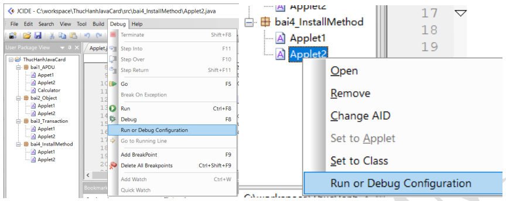
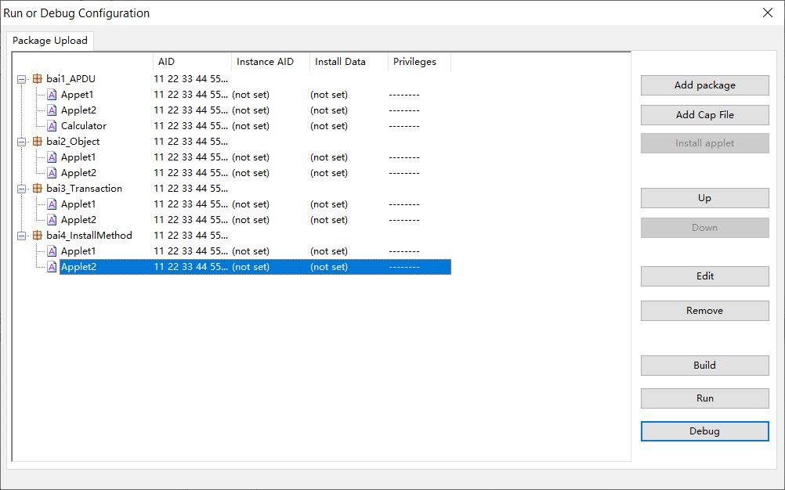
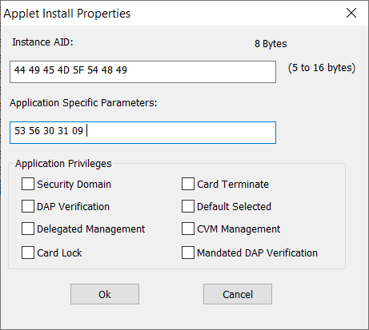

# BÀI THỰC HÀNH SỐ 4 PHƯƠNG THỨC INSTALL

> Nguồn: `853437769-1763429266255-baithuchanhso4-phuongthucinstall.pdf` · 10 trang · Cao Vinh - CNTT
> Chuyển từ PDF sang Markdown ngày 03/11/2026. Hình giữ dạng ảnh; chữ, mã và thông số trong hình được chép lại ngay dưới ảnh. Ghi chú của người chuyển đổi bắt đầu bằng "Ghi chú chuyển đổi".

Phương thức `install` thường được JCRE gọi là bước cuối cùng trong quá trình cài đặt Applet để tạo một cá thể Applet - một ứng dụng có thể chạy được. Phương thức `install` tương tự như phương thức `main` trong một ứng dụng Java. Các đối số của phương thức `install` – chính là các tham số cài đặt Applet, chúng tương tự như các đối số được cung cấp cho phương thức `main`.

Phương thức `install` tạo ra một cá thể Applet bằng cách sử dụng toán tử `new` theo sau là một lệnh gọi đến hàm tạo (constructor) của Applet. Trong hàm tạo, một Applet thường thực hiện các tác vụ sau:

- Tạo các đối tượng mà Applet cần trong suốt vòng đời của nó
- Khởi tạo các đối tượng và các biến cục bộ của Applet
- Đăng ký thực thể Applet với JCRE bằng cách gọi một trong hai phương thức `register` được định nghĩa trong lớp Applet cơ sở.

Hàm tạo có thể không chứa tham số nào hoặc có chứa các tham số cài đặt. Ví dụ chúng ta có Applet lưu điểm thi của sinh viên với hàm tạo được viết như sau:

```java
public class Applet1 extends Applet
{
    final static byte SO_LUONG_MON_HOC = (byte)10;
    private byte [] monhoc, diem;

    public static void install(byte[] bArray, short bOffset, byte bLength)
    {
        new Applet1();
    }

    //ham tao
    private Applet1()
    {
        //tao mang byte luu tru ID cua mon hoc
        monhoc = new byte[SO_LUONG_MON_HOC];
        //tao mang byte luu tru diem thi
        diem = new byte[SO_LUONG_MON_HOC];
        //dang ky Applet
        register();
    }
}
```

> **Ghi chú chuyển đổi:** Trong PDF, các dòng mã dài bị ngắt xuống dòng sát lề trái do độ rộng trang (ví dụ phần `byte bLength)` của khai báo `install`); ở đây các dòng đó được nối lại thành một dòng. Các đoạn mã phía sau được xử lý tương tự.

Ngoài ra, chúng ta có thể định nghĩa một hàm tạo lấy các tham số cài đặt.

```java
private Applet1(byte[] bArray, short bOffset, byte bLength) {...}
```

Các tham số cài đặt cung cấp dữ liệu bổ sung để khởi tạo và cá nhân hóa Applet.

## 4.1 Tạo đối tượng trong hàm tạo của Applet

Mặc dù các đối tượng và mảng có thể được tạo tại bất kỳ điểm nào trong quá trình thực thi một Applet, nhưng khi có thể nên đặt nó vào quá trình khởi tạo Applet. Bất kỳ đối tượng nào (có thể được yêu cầu trong quá trình thực thi một Applet) nên được đặt trước trong hàm tạo, để đảm bảo rằng Applet sẽ không bao giờ bị lỗi do thiếu bộ nhớ.

Hàm tạo được gọi bên trong phương thức `install`. Do đó, nếu JCRE phát hiện thiếu tài nguyên và không thể phân bổ dung lượng bộ nhớ cho Applet trong khi tạo đối tượng hoặc trong một số xử lý phân bổ tài nguyên khác, JCRE sẽ xóa Applet và lấy lại toàn bộ không gian bộ nhớ. Theo cách này, không có Applet nào được tạo một phần sẽ bị bỏ lại trong trạng thái không thể truy cập được.

Tuy nhiên, một Applet không nên tạo ra nhiều đối tượng hơn mức cần thiết, vì bộ nhớ bị chiếm bởi các đối tượng không sử dụng có thể được sử dụng lại hoặc chia sẻ bởi các Applet khác hoặc JCRE.

## 4.2 Đăng ký thực thể Applet với JCRE

Để đăng ký một Applet với JCRE, chúng ta sử dụng một trong hai phương thức `register` được cung cấp trong lớp `Applet` cơ sở:

```java
   protected final void register()
```

hoặc

```java
   protected final void register (byte[] bArray, short bOffset, byte bLength)
```

Phương thức `register` có hai chức năng. Đầu tiên, nó lưu trữ một tham chiếu đến thực thể Applet với JCRE. Thứ hai, nó gán AID cho thực thể Applet. Như đã biết, mỗi thực thể Applet trên thẻ được xác định duy nhất bởi AID. File CAP xác định các lớp Applet chứa AID mặc định. Tuy nhiên, một Applet có thể có AID khác với AID mặc định. AID mặc định có thể được cung cấp trong các tham số cài đặt.

Phương thức `register` đầu tiên (phương thức không có đối số) đăng ký Applet với JCRE bằng AID mặc định từ file CAP. Phương thức `register` thứ hai (có đối số) đăng ký thực thể Applet với JCRE bằng AID được chỉ định trong đối số `bArray`. Đối số `bOffset` chỉ định phần bù bắt đầu bằng `bArray` và `bLength` chỉ định độ dài AID tính bằng byte.

## 4.3 Xử lý các tham số cài đặt

Thông thường, trong quá trình cài đặt Applet, các tham số cài đặt được gửi đến thẻ cùng với các file CAP định nghĩa một Applet. JCRE sau đó cung cấp các tham số cài đặt cho Applet thông qua các đối số cho phương thức `install`. Phương thức `install` sẽ chấp nhận ba đối số:

- `byte [] bArray` – mảng chứa các tham số cài đặt
- `short bOffset` – phần bù bắt đầu trong `bArray`
- `byte bLength` – độ dài dữ liệu tham số trong `bArray` tính bằng byte

Nội dung và định dạng của các tham số cài đặt được xác định bởi các nhà thiết kế Applet hoặc tổ chức phát hành thẻ. Thông thường, chúng chứa các tham số cấu hình Applet và giá trị khởi tạo Applet. Các tham số cấu hình có thể được sử dụng để chỉ định kích thước của file nội bộ, mảng, v.v. Bằng cách này, Applet có thể phân bổ bộ nhớ đầy đủ để hỗ trợ các xử lý dự đoán trong khi tránh lãng phí bộ nhớ.

Từ phiên bản Java Card 2.1.2, nội dung và định dạng của tham số cài đặt phải có định dạng và độ dài như quy định dưới đây:

- `Li = bArray[bOffset]` – độ dài của AID,
- `bArray[bOffset+1..bOffset+Li]` – các byte AID,
- `Lc = bArray[bOffset+Li+1]` – độ dài của thông tin điều khiển,
- `bArray[bOffset+Li+2..bOffset+Li+Lc+1]` – các byte thông tin điều khiển,
- `La = bArray[bOffset+Li+Lc+2]` – độ dài của dữ liệu Appet
- `bArray[bOffset+Li+Lc+3..bOffset+Li+Lc+La+2]` – các byte dữ liệu Applet

Các trường Li, Lc và La đều có thể nhận giá trị 0. Các thông tin điều khiển phụ thuộc vào việc thực thi Applet và được chỉ định bởi trình cài đặt.

## 4.4 Ví dụ

Giả sử, Applet lưu điểm của sinh viên ở trên có giá trị khởi tạo là ID sinh viên, số môn thi và AID của Applet, cụ thể như sau:

- Mảng byte có kích thước thay đổi chỉ định AID của Applet, nếu mảng này trống thì Applet sử dụng AID mặc định từ CAP.
- Mảng có kích thước cố định 4 byte chỉ định ID của sinh viên;
- 01 byte chỉ định số môn thi;

Khi đó, chúng ta cần tạo Applet lưu điểm của sinh viên với các tham số cài đặt mặc định là:

- AID của Applet: [‘D’, ‘I’, ‘E’, ‘M’, ‘_’, ‘T’, ‘H’, ‘I’] = [0x44, 0x49, 0x45, 0x4D, 0x5F, 0x54, 0x48, 0x49].
- ID của sinh viên: [‘S’, ‘V’, ‘0’, ‘1’] = [0x53, 0x56, 0x30, 0x31];
- Số môn thi: 0x09 = 9;

Chúng ta có thể xây dựng Applet này như sau:

```java
public class Applet2 extends Applet
{
    final static byte SV_ID_LENGTH          = (byte)0x04;

    private static byte [] diemThi, sinhVien;
    private static byte soLuongMonThi;
    public static void install(byte[] bArray, short bOffset, byte bLength)
    {
        new Applet2(bArray, bOffset, bLength);
    }

    private Applet2(byte[] bArray, short bOffset, byte bLength)
    {

        // kiem tra du lieu den
        byte iLen = bArray[bOffset]; // do dai AID
        if(iLen == 0)
        {
            //dang ky Applet voi JCRE su dung AID mac dinh
            register();
        }
        else
        {
            //dang ky Applet voi JCRE su dung AID duoc chi dinh trong tham so cai dat
            register(bArray, (short)(bOffset +1), iLen);
        }
        bOffset = (short) (bOffset+iLen+1);
        byte cLen = bArray[bOffset]; // do dai thong tin dieu khien
        bOffset = (short) (bOffset+cLen+1);
        byte aLen = bArray[bOffset]; // do dai du lieu Applet
        bOffset = (short) (bOffset + 1);
        // doc du lieu Applet
        if (aLen != 0)
        {
            //gan ID cua sinh vien
            sinhVien = new byte[SV_ID_LENGTH];
            Util.arrayCopy(bArray, bOffset, sinhVien, (byte)0, SV_ID_LENGTH);
            bOffset += SV_ID_LENGTH;
            //gan so mon thi
            soLuongMonThi = bArray[bOffset];
        }
        else
        {
            //gan ID cua sinh vien  va so luong mon thi
            sinhVien = new byte[] {'S', 'V', '0','1'};
            soLuongMonThi = (byte)0x08;
        }

    }
public void process(APDU apdu)
    {
        if (selectingApplet())
        {
            return;
        }
        byte[] buf = apdu.getBuffer();
        apdu.setIncomingAndReceive();
        switch (buf[ISO7816.OFFSET_INS])
        {
        case (byte)0x00:
            //in ra ID cua sinh vien va so luong mon thi
            apdu.setOutgoing();
            apdu.setOutgoingLength((short)5);
            apdu.sendBytesLong(sinhVien, (short)0, SV_ID_LENGTH);
            buf[0] = soLuongMonThi;
            apdu.sendBytes((short)0, (short)1);
            break;
        default:
            ISOException.throwIt(ISO7816.SW_INS_NOT_SUPPORTED);
        }
    }}
```

> **Ghi chú chuyển đổi:** Trong PDF, dòng `ISOException.throwIt(ISO7816.SW_INS_NOT_SUPPORTED);` sau `default:` bị ngắt dòng do quá dài: hiện thành một dòng trống rồi một dòng thụt lề ít hơn `default:`. Ở đây dòng này được đặt ngay dưới `default:`, cùng mức thụt lề với các lệnh trong `case`. Các mức thụt lề khác (kể cả dòng `public void process(APDU apdu)` sát lề trái) giữ như bản gốc.

Để cài đặt các tham số cho Applet, chúng ta vào **Debug→Run or Debug Configuration**, hoặc kích chuột phải vào package hoặc Applet chọn **Run or Debug Configuration** (Hình 4.1).



*Hình 4.1 Cách vào chức năng “Run or Debug Configuration”*

Thông tin trong hình:
- Ảnh bên trái: cửa sổ `JCIDE - C:\workspace\ThucHanhJavaCard\src\bai4_InstallMethod\Applet2.java`
  - Thanh menu: File, Edit, Search, View, Tool, Build, Debug (đang mở), Help
  - User Package View, cây ThucHanhJavaCard:
    - bai1_APDU: Appet1, Applet2, Calculator
    - bai2_Object: Applet1, Applet2
    - bai3_Transaction: Applet1, Applet2
    - bai4_InstallMethod: Applet1, Applet2
  - Menu Debug: Terminate Shift+F8 (mờ); Step Into F11 (mờ); Step Over F10 (mờ); Step Return Shift+F11 (mờ); Go F5; Break On Exception (mờ); Run Ctrl+F8; Debug F8; Run or Debug Configuration (đang chọn); Go to Running Line (mờ); Add BreakPoint F9; Delete All Breakpoints Ctrl+Shift+F9; Add Watch Ctrl+W (mờ); Quick Watch (mờ)
  - Vùng soạn thảo phía sau bị menu che, chỉ thấy cột số dòng 8–20
- Ảnh bên phải: cây gói bai4_InstallMethod với Applet1, Applet2 (đang chọn), phía trên còn thấy một phần dòng Applet2 của gói trước; cạnh đó là số dòng 17, 18, 19 của vùng soạn thảo
  - Menu chuột phải: Open, Remove, Change AID, Set to Applet (mờ), Set to Class, Run or Debug Configuration (đang chọn)



*Hình 4.2 Cửa sổ “Run or Debug Configuration”*

Thông tin trong hình:
- Cửa sổ: Run or Debug Configuration; tab: Package Upload
- Nút bên phải: Add package, Add Cap File, Install applet (mờ), Up, Down (mờ), Edit, Remove, Build, Run, Debug
- Bảng gói và Applet (giá trị cột AID bị cắt ngắn trong cửa sổ; dòng Applet2 cuối cùng đang được chọn):

| | AID | Instance AID | Install Data | Privileges |
| --- | --- | --- | --- | --- |
| bai1_APDU | 11 22 33 44 55... | | | |
| Appet1 | 11 22 33 44 55... | (not set) | (not set) | -------- |
| Applet2 | 11 22 33 44 55... | (not set) | (not set) | -------- |
| Calculator | 11 22 33 44 55... | (not set) | (not set) | -------- |
| bai2_Object | 11 22 33 44 55... | | | |
| Applet1 | 11 22 33 44 55... | (not set) | (not set) | -------- |
| Applet2 | 11 22 33 44 55... | (not set) | (not set) | -------- |
| bai3_Transaction | 11 22 33 44 55... | | | |
| Applet1 | 11 22 33 44 55... | (not set) | (not set) | -------- |
| Applet2 | 11 22 33 44 55... | (not set) | (not set) | -------- |
| bai4_InstallMethod | 11 22 33 44 55... | | | |
| Applet1 | 11 22 33 44 55... | (not set) | (not set) | -------- |
| Applet2 | 11 22 33 44 55... | (not set) | (not set) | -------- |



*Hình 4.3 Cửa sổ “Applet Install Properties”*

Thông tin trong hình:
- Cửa sổ: Applet Install Properties
- Instance AID: `44 49 45 4D 5F 54 48 49` (bên cạnh: 8 Bytes; (5 to 16 bytes))
- Application Specific Parameters: `53 56 30 31 09`
- Application Privileges (không ô nào được đánh dấu): Security Domain, Card Terminate, DAP Verification, Default Selected, Delegated Management, CVM Management, Card Lock, Mandated DAP Verification
- Nút: Ok, Cancel

Khi đó một cửa sổ để cấu hình sẽ hiện ra như Hình 4.2, để cấu hình các tham số cài đặt Applet chúng ta có thể kích đúp vào Applet muốn cấu hình hoặc chọn Applet cần cấu hình sau đó ấn **Edit**. Một cửa số để nhập các tham số cài đặt Applet sẽ hiện ra như Hình 4.3. Tại đây, chúng ta sẽ nhập vào AID của Applet và các tham số cài đặt.

Chúng ta tiến hành chạy Applet vừa viết, kiểm tra xem Applet này đã nhận các tham số cài đặt chưa, kết quả như sau:

```text
>> /select 4449454D5F544849
>> 00 A4 04 00 08 44 49 45 4D 5F 54 48 49 00
<< 90 00

>> /send 00000102
>> 00 00 01 02
<< 53 56 30 31 09 90 00
```

Kết quả này cho ta thấy các tham số cài đăt đã được xử lý khi thực thi Applet.

## 4.5 Bài tập

Viết Applet lưu điểm thi sinh viên với các tham số cài đặt mặc định là:

- AID của Applet: [‘D’, ‘I’, ‘E’, ‘M’, ‘_’, ‘T’, ‘H’, ‘I’] = [0x44, 0x49, 0x45, 0x4D, 0x5F, 0x54, 0x48, 0x49].
- ID của sinh viên: [‘S’, ‘V’, ‘0’, ‘1’] = [0x53, 0x56, 0x30, 0x31];
- Số môn thi: 0x09 = 9;

Applet này có 4 chức năng chính: nhập điểm, in điểm, sửa điểm và xóa điểm. Điểm thi được lưu trong mảng byte `diemThi`, với mỗi môn thi lưu vào phần tử liên tiếp của mảng `diemThi` theo thứ tự 1 byte ID môn học, 1 byte điểm thi (ví dụ [0x01, 0x08, 0x02, 0x06, 0x04, 0x09]). Chức năng in điểm sẽ in tất cả các điểm thi đã được nhập vào mảng diemThi, sau mỗi lần nhập điểm, sửa điểm và xóa điểm đều thực hiện in điểm thi. Lưu ý: ID môn học không được trùng nhau, số điểm thi nhập vào không được vượt quá số môn thi.
