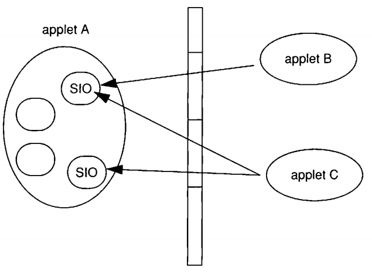

# BÀI THỰC HÀNH SỐ 5 CHIA SẺ ĐỐI TƯỢNG GIỮA CÁC APPLET

> Nguồn: `357612486-1763429325010-baithuchanhso5-chiasedoituonggiuacacapplet.pdf` · 17 trang · Cao Vinh - CNTT
> Chuyển từ PDF sang Markdown ngày 03/11/2026. Hình giữ dạng ảnh; chữ, mã và thông số trong hình được chép lại ngay dưới ảnh. Ghi chú của người chuyển đổi bắt đầu bằng "Ghi chú chuyển đổi".

Công nghệ Java Card cũng cho phép chia sẻ đối tượng giữa các Applet thông qua cơ chế giao diện có thể chia sẻ.

## 5.1 Giao diện có thể chia sẻ

Giao diện có thể chia sẻ chỉ đơn giản là một giao diện mở rộng, trực tiếp hoặc gián tiếp, của giao diện `javacard.framework.Shareable`.

```java
public interface Shareable {}
```

Giao diện này có khái niệm tương tự như giao diện `Remote` được sử dụng bởi bộ phận RMI (Remote method invocation). Giao diện không định nghĩa bất kỳ phương thức hoặc trường nào. Mục đích duy nhất của nó là được mở rộng bởi các giao diện khác và gắn thẻ các giao diện đó là có các thuộc tính đặc biệt.

Một giao diện có thể chia sẻ xác định một tập hợp các phương thức có sẵn cho các Applet khác. Một lớp có thể thực thi bất kỳ số lượng giao diện có thể chia sẻ và có thể mở rộng các lớp khác thực thi giao diện có thể chia sẻ.

## 5.2 Đối tượng của giao diện có thể chia sẻ

Một đối tượng của lớp thực hiện giao diện có thể chia sẻ được gọi là đối tượng giao diện có thể chia sẻ (SIO – shareable interface object). Đối với bối cảnh sở hữu, SIO là một đối tượng bình thường có các trường và phương thức có thể được truy cập. Đối với bất kỳ bối cảnh nào khác, SIO là một thể hiện của loại giao diện có thể chia sẻ và chỉ các phương thức được xác định trong giao diện có thể chia sẻ thì mới có thể truy cập được. Tất cả các trường và các phương thức khác của SIO được bảo vệ bởi tường lửa.

## 5.3 Ý tưởng phía sau cơ chế giao diện có thể chia sẻ

Applet lưu trữ dữ liệu trong các đối tượng. Chia sẻ dữ liệu giữa các Applet có nghĩa là một Applet cho phép một đối tượng mà nó sở hữu có thể dùng cho các Applet khác, do đó chia sẻ dữ liệu được gói gọn trong đối tượng.

Trong thế giới hướng đối tượng, một hành vi của đối tượng (ngoài truy cập biến trực tiếp) được thể hiện thông qua các phương thức của nó. Truyền tin nhắn, hoặc gọi phương thức, hỗ trợ các tương tác và liên lạc giữa các đối tượng. Cơ chế giao diện có thể chia sẻ cho phép các Applet gửi tin nhắn bỏ qua sự giám sát của tường lửa. Một Applet sở hữu tạo ra một đối tượng giao diện có thể chia sẻ và thực thi các phương thức được xác định trong giao diện có thể chia sẻ. Các phương thức này đại diện cho giao diện chung của Applet sở hữu, thông qua đó một Applet khác có thể gửi tin nhắn và từ đó truy cập các dịch vụ được cung cấp bởi Applet này.

Kịch bản chia sẻ được minh họa trong Hình 5.1 có thể được mô tả như mối quan hệ máy khách/máy chủ. Applet A (cung cấp SIO) là một máy chủ và Applet B và C (sử dụng SIO của Applet A) là máy khách. Một Applet có thể là một máy chủ cho một số Applet và là khách hàng của các Applet khác.



*Hình 5.1 Cơ chế đối tượng của giao diện có thể chia sẻ*

Chữ trong hình:
- applet A (hình elip bên trái): hai ô SIO và hai ô tròn không có nhãn
- applet B → SIO (ô SIO phía trên trong applet A)
- applet C → SIO (ô SIO phía trên) và applet C → SIO (ô SIO phía dưới)
- Giữa applet A và hai applet B, C là một cột dọc chia ô, không có nhãn; các mũi tên đi qua cột này

Trong ngôn ngữ lập trình Java, một giao diện định nghĩa một kiểu tham chiếu có chứa một tập hợp các chữ ký và hằng. Một Applet khách xem SIO như kiểu giao diện có thể chia sẻ. Loại lớp của SIO thực thi giao diện có thể chia sẻ không bị tiết lộ. Nói cách khác, chỉ các phương thức được định nghĩa trong giao diện có thể chia sẻ được đưa ra cho Applet máy khách; các trường ví dụ và các phương thức khác không được tiết lộ. Theo cách này, một Applet máy chủ có thể cung cấp quyền truy cập được kiểm soát vào dữ liệu mà nó muốn chia sẻ.

Khi tương tác với một Applet khách khác, một Applet máy chủ có thể giữ một vai trò khác. Điều này sẽ yêu cầu Applet máy chủ tùy chỉnh các dịch vụ của nó đối với Applet của máy khách mà không cần mở rộng. Một Applet máy chủ có thể làm như vậy bằng cách định nghĩa nhiều giao diện, mỗi giao diện của phương thức khai báo phù hợp với một nhóm các Applet máy khách. Nếu các phương thức trong các giao diện là khác biệt, một Applet máy chủ có thể chọn tạo các lớp, mỗi lớp thực thi một giao diện. Nhưng các dịch vụ thường chồng chéo; một Applet máy chủ có thể định nghĩa một lớp thực thi nhiều giao diện. Do đó, một SIO của lớp đó có thể giữ nhiều vai trò.

## 5.4 Ví dụ

Chúng ta có 2 Applet: Applet chủ `masterApp` và Applet khách `slaveApp` nằm ở trong các bối cảnh khác nhau (nghĩa là chúng được đặt trong các gói riêng biệt), giả sử Applet chủ muốn chia sẻ một mảng byte với Applet khách.

Để thực hiện chia sẻ đối tượng giữa các Applet, chúng ta làm theo các bước sau:

**Bước 1: Tạo đối tượng của giao diện có thể chia sẻ được**

Để tạo SIO, đầu tiên Applet chủ `masterApp` định nghĩa giao diện có thể chia sẻ là mở rộng của `javacard.framework.Shareable`. Ở đây, sẽ định nghĩa phương thức `getArray` dùng để chia sẻ đối tượng

```java
package masterPack;
import javacard.framework.Shareable;

public interface masterInterface extends Shareable{
    public short getArray(byte[] array);
}
```

Tiếp theo, Applet máy chủ tạo ra một lớp nhà cung cấp dịch vụ (một lớp nhà cung cấp dịch vụ có thể là chính lớp Applet) thực thi giao diện có thể chia sẻ. Applet máy chủ sau đó có thể tạo một hoặc nhiều đối tượng của lớp nhà cung cấp dịch vụ và có thể chia sẻ các đối tượng đó (SIO) với các Applet khác trong một bối cảnh khác. Trong Applet `masterApp` sẽ chỉ ra cách thức thực hiện của phương thức `getArray`

```java
package masterPack;
import javacard.framework.*;

public class masterApp extends Applet implements masterInterface
{
    private byte[] testArray;
    private masterApp()
    {
        testArray = new byte[]{0x01, 0x02, 0x03, 0x04, 0x05};
    }

    public static void install(byte[] bArray, short bOffset, byte bLength)
    {
        new masterApp().register(bArray, (short) (bOffset + 1), bArray[bOffset]);
    }


    public short getArray(byte[] buf) {
        short len = (short)testArray.length;
        Util.arrayCopy(testArray, (short)0, buf, (short)0, len);
        return len;
    }
}
```

> **Ghi chú chuyển đổi:** Trong PDF, các dòng mã dài bị ngắt xuống dòng sát lề trái do độ rộng trang (ví dụ `byte bLength)`, `bArray[bOffset]);`, `len);` trong đoạn mã trên); ở đây các dòng đó được nối lại thành một dòng. Các đoạn mã phía sau được xử lý tương tự, kể cả chỗ tên biến `masterAID` bị ngắt giữa chừng thành `mast` ở cuối dòng và `erAID` ở đầu dòng sau.

Trước khi khách hàng có thể yêu cầu SIO, nó phải tìm cách xác định máy chủ. Trong nền tảng Java Card, mỗi cá thể Applet được xác định duy nhất bởi một AID.

**Bước 2: Yêu cầu một đối tượng của giao diện có thể chia sẻ**

Trước khi yêu cầu SIO từ một Applet máy chủ, trước tiên, một Applet máy khách phải có được đối tượng AID được liên kết với Applet máy chủ. Để làm điều đó, Applet máy khách gọi phương thức `lookupAID` trong lớp `JCSystem`;

```java
public static AID lookupAID
     (byte[] buffer, short offset, byte length)
```

Applet máy khách phải biết trước các byte AID của Applet máy chủ và nó cung cấp các byte AID trong bộ đệm tham số. Phương thức `lookupAID` trả về đối tượng AID do JCRE sở hữu của Applet máy chủ hoặc trả về `null` nếu Applet máy chủ không được cài đặt trên thẻ.

Tiếp theo, Applet máy khách gọi phương thức `JCSystem.getAppletShareableInterfaceObject`, sử dụng đối tượng AID để xác định máy chủ:

```java
public static Shareable getAppletShareableInterfaceObject
     (AID server_aid, byte parameter)
```

Tham số thứ hai trong phương thức `getAppletShareableInterfaceObject` được diễn giải bởi Applet máy chủ. Nó có thể được sử dụng để chọn SIO nếu máy chủ có sẵn nhiều hơn một. Ngoài ra, tham số có thể được sử dụng làm mã thông báo bảo mật, mang một bí mật được chia sẻ bởi máy chủ và máy khách.

Trong phương thức `getAppletShareableInterfaceObject`, JCRE tra cứu Applet máy chủ bằng cách so sánh `server_aid` với AID của các Applet được đăng ký với JCRE. Nếu không tìm thấy Applet máy chủ, JCRE trả về `null`. Mặt khác, JCRE gọi phương thức `getShareableInterfaceObject` của Applet máy chủ.

```java
public Shareable
getShareableInterfaceObject(AID client_aid, byte parameter)
```

Lưu ý rằng, trong phương thức `getShareableInterfaceObject`, JCRE thay thế đối số đầu tiên bằng đối tượng `client_aid` và gửi cùng byte tham số được cung cấp bởi Applet máy khách. Applet máy chủ sử dụng cả hai tham số để xác định xem có cung cấp dịch vụ cho Applet yêu cầu hay không và nếu có thì SIO nào sẽ xuất.

Phương thức `getShareableInterfaceObject` được định nghĩa trong lớp Applet cơ sở `javacard.framework.Applet`. Việc thực thi mặc định trả về `null`. Một lớp Applet phải ghi đè phương thức này nếu nó có ý định chia sẻ bất kỳ SIO nào. Dưới đây là cách Applet `masterApp` thực hiện phương thức `getShareableInterfaceObject`

```java
    public Shareable getShareableInterfaceObject(AID clientAID, byte parameter) {
        //xac thuc nguoi dung
        if(parameter != (byte)0x00)
            return null;
        return this;
    }
```

Khi đó, code đầy đủ của Applet masterApp được viết như sau:

```java
package masterPack;
import javacard.framework.*;

public class masterApp extends Applet implements masterInterface
{
    private byte[] testArray;

    private masterApp()
    {
        testArray = new byte[]{0x01, 0x02, 0x03, 0x04, 0x05};
    }

    public static void install(byte[] bArray, short bOffset, byte bLength)
    {
        new masterApp().register(bArray, (short) (bOffset + 1), bArray[bOffset]);
    }

    public void process(APDU apdu)
    {
        if (selectingApplet())
        {
            return;
        }

        byte[] buf = apdu.getBuffer();
        apdu.setIncomingAndReceive();
        switch (buf[ISO7816.OFFSET_INS])
        {
        case (byte)0x00:
            break;
        default:
            ISOException.throwIt(ISO7816.SW_INS_NOT_SUPPORTED);
        }
    }

    public Shareable getShareableInterfaceObject(AID clientAID, byte parameter) {
        //xac thuc nguoi dung
        if(parameter != (byte)0x00)
            return null;
        return this;
    }

    public short getArray(byte[] buf) {
        short len = (short)testArray.length;
        Util.arrayCopy(testArray, (short)0, buf, (short)0, len);
        return len;
    }
}
```

> **Ghi chú chuyển đổi:** Trong PDF, dòng `ISOException.throwIt(ISO7816.SW_INS_NOT_SUPPORTED);` sau `default:` bị ngắt dòng do quá dài: hiện thành một dòng trống rồi một dòng thụt lề ít hơn `default:`. Ở đây dòng này được đặt ngay dưới `default:`, cùng mức thụt lề với các lệnh trong `case`; các đoạn mã phía sau được xử lý tương tự.

**Bước 3: Sử dụng đối tượng của giao diện có thể chia sẻ được**

Để cho phép máy chủ trả về bất kỳ loại giao diện có thể chia sẻ nào bằng một giao diện duy nhất, cả hai phương thức `JCSystem.getAppletShareableInterfaceObject` và `Applet.getShareableInterfaceObject` đều có kiểu trả về là `Shareable` - loại cơ sở của tất cả các đối tượng giao diện có thể chia sẻ. Một Applet khách phải cho phép SIO trả về kiểu giao diện con thích hợp và lưu nó trong một tham chiếu đối tượng của loại đó. Ví dụ: Applet `slaveApp` chuyển SIO thành `masterInterface`:

```java
masterInterface sio = (masterInterface)(JCSystem.getAppletShareableInterfaceObject(masterAID, (byte)0));
```

Sau khi ứng dụng khách nhận được SIO, nó gọi các phương thức giao diện có thể chia sẻ để truy cập các dịch vụ từ máy chủ. Tuy nhiên, Applet máy khách chỉ có thể thấy các phương thức được định nghĩa trong giao diện có thể chia sẻ được.

Chẳng hạn, trong đoạn code trước, mặc dù `sio` thực sự trỏ đến Applet `masterApp` (lớp Applet của nó thực hiện giao diện `masterInterface`), tất cả các trường đối tượng và phương thức giao diện không thể chia sẻ (như phương thức `process`, `select`) đều được bảo vệ bởi tường lửa.

Dưới đây là code đầy đủ của Applet `slaveApp`:

```java
package slavePack;
import javacard.framework.*;
import masterPack.masterInterface;

public class slaveApp extends Applet
{
    final static byte[] serverAID = new byte[] {0x11,0x22,0x33,0x44,0x55,0x05,0x00,0x00};
    public static void install(byte[] bArray, short bOffset, byte bLength)
    {
        new slaveApp().register(bArray, (short) (bOffset + 1), bArray[bOffset]);
    }

    public void process(APDU apdu)
    {
        if (selectingApplet())
        {
            return;
        }

        byte[] buf = apdu.getBuffer();
        apdu.setIncomingAndReceive();
        switch (buf[ISO7816.OFFSET_INS])
        {
        case (byte)0x00:
            AID masterAID = JCSystem.lookupAID(serverAID, (short)0, (byte)serverAID.length);
            masterInterface sio = (masterInterface)(JCSystem.getAppletShareableInterfaceObject(masterAID, (byte)0x00));
            short len = sio.getArray(buf);
            apdu.setOutgoingAndSend((short)0, len);

            break;
        default:
            ISOException.throwIt(ISO7816.SW_INS_NOT_SUPPORTED);
        }
    }
}
```

Kết quả thực thi Applet `slaveApp` như sau:

```text
>> /select 1122334455050101
>> 00 A4 04 00 08 11 22 33 44 55 05 01 01 00
<< 90 00

>> /send 00000102
>> 00 00 01 02
<< 01 02 03 04 05 90 00
```

## 5.5 Các kiểu tham số và kiểu trả về trong các phương thức giao diện có thể chia sẻ

Trong ngôn ngữ lập trình Java, các tham số của phương thức và giá trị trả về có thể là bất kỳ kiểu cơ bản hoặc tham chiếu nào. Nhưng trong nền tảng Java Card, việc truyền các đối tượng (bao gồm cả mảng) làm tham số hoặc trả về giá trị trong phương thức giao diện có thể chia sẻ được cho phép theo kiểu hạn chế.

Ví dụ: nếu Applet `slaveApp` ở ví dụ trên sử dụng một trong các đối tượng của chính nó là mảng `array` làm tham số trong phương thức `getArray`

```java
            AID masterAID = JCSystem.lookupAID(serverAID, (short)0, (byte)serverAID.length);
            masterInterface sio = (masterInterface)(JCSystem.getAppletShareableInterfaceObject(masterAID, (byte)0x00));
            //su dung mang array lam doi so co phuong thuc cua giao dien co the chia se
            byte [] array = new byte[5];
            short len = sio.getArray(array);
            Util.arrayCopy(array, (short)0, buf, (short)0, len);
            apdu.setOutgoingAndSend((short)0, len);
```

Khi đó, tường lửa sẽ ngăn không cho Applet masterApp truy cập vào mảng này, kết quả là một ngoại lệ sẽ được trả ra:

```text
>> /send 00000102
>> 00 00 01 02
<< 6F 00   No precise diagnosis
```

Tương tự, nếu Applet `masterApp` trả về một trong các đối tượng của chính nó làm giá trị trả về, tường lửa sẽ ngăn Applet `slaveApp` truy cập vào đối tượng này. Mặc dù điều này có vẻ bất tiện, nhưng thực chất là tường lửa Applet đang làm công việc của nó.

Để tránh vấn đề này, các loại giá trị sau có thể được truyền vào trong các phương thức giao diện có thể chia sẻ dưới dạng tham số và giá trị trả về:

- Các giá trị cơ bản - chúng dễ dàng được truyền vào ngăn xếp. Các kiểu cơ bản được hỗ trợ trong nền tảng Java Card là `boolean`, `byte`, `short` và (tùy chọn) `int`.
- Các trường tĩnh - các trường tĩnh công khai có thể truy cập được từ bất kỳ bối cảnh nào. Tuy nhiên, các đối tượng được tham chiếu bởi các trường tĩnh như vậy được bảo vệ bởi tường lửa.
- Đối tượng điểm nhập JCRE - phương thức công khai của các đối tượng này có thể được truy cập từ bất kỳ bối cảnh nào.
- Mảng toàn cục - Chúng có thể được truy cập từ bất kỳ bối cảnh nào. Ví dụ, bộ đệm APDU có thể được sử dụng cho mục đích này.
- SIO - Phương thức giao diện có thể chia sẻ của các đối tượng này có thể được truy cập từ bất kỳ ngữ cảnh nào. SIO được trả về từ máy khách cho phép bối cảnh máy chủ gọi lại vào ngữ cảnh máy khách để lấy một số dịch vụ hoặc dữ liệu. Tuy nhiên, nhà phát triển nên cẩn thận để tránh chuyển đổi ngữ cảnh quá mức (có thể làm giảm độ hoàn hảo) và lồng sâu (deep nesting) các chuyển đổi ngữ cảnh (có thể sử dụng thêm không gian ngăn xếp).

Để hiểu rõ hơn về vấn đề này, chúng ta xét ví dụ sau: giả sử trong giao diện có thể chia sẻ `masterInterface` có phương thức

```java
    public byte tinhDiem(byte diemToan, byte diemVan){
        byte diemTB = (byte)((byte)((byte)(6*diemToan) + (byte)(4*diemVan))/10);
        return diemTB;
    }
```

**Kịch bản 1**: Đầu tiên chúng ta xem xét trường hợp các tham số và giá trị trả về của phương thức `tinhDiem` đều là các kiểu dữ liệu cơ bản:

```java
package slavePack;

import javacard.framework.*;
import masterPack.masterInterface;

public class slaveApp extends Applet
{
    final static byte[] serverAID = new byte[] {0x11,0x22,0x33,0x44,0x55,0x05,0x00,0x00};

    public static void install(byte[] bArray, short bOffset, byte bLength)
    {
        new slaveApp().register(bArray, (short) (bOffset + 1), bArray[bOffset]);
    }

    public void process(APDU apdu)
    {
        if (selectingApplet())
        {
            return;
        }

        byte[] buf = apdu.getBuffer();
        apdu.setIncomingAndReceive();
        switch (buf[ISO7816.OFFSET_INS])
        {
        case (byte)0x00:
            AID masterAID = JCSystem.lookupAID(serverAID, (short)0, (byte)serverAID.length);
            masterInterface sio = (masterInterface)(JCSystem.getAppletShareableInterfaceObject(masterAID, (byte)0x00));
            /*su dung cac kieu du lieu so ban lam tham so va gia tri tra ve*/
            byte diemToan = (byte)0x08;
            byte diemVan = (byte)0x09;
            byte diemTB = sio.tinhDiem(diemToan, diemVan);
            buf[0] = diemTB;
            apdu.setOutgoingAndSend((short)0, (short)(1));

            break;
        default:
            ISOException.throwIt(ISO7816.SW_INS_NOT_SUPPORTED);
        }
    }
}
```

Kết quả thực thi Applet này như sau:

```text
>> /select 1122334455050101
>> 00 A4 04 00 08 11 22 33 44 55 05 01 01 00
<< 90 00

>> /send 00000102
>> 00 00 01 02
<< 08 90 00
```

**Kịch bản 2:** sử dụng các trường của đối tượng `sinhVien` làm tham số và giá trị trả về của phương thức `tinhDiem`

```java
package slavePack;
import javacard.framework.*;
import masterPack.masterInterface;

public class slaveApp1 extends Applet
{
    final static byte[] serverAID = new byte[] {0x11,0x22,0x33,0x44,0x55,0x05,0x00,0x00};
    sinhVien sv1;


    public static void install(byte[] bArray, short bOffset, byte bLength)
    {
        new slaveApp().register(bArray, (short) (bOffset + 1), bArray[bOffset]);
    }

    public void process(APDU apdu)
    {
        if (selectingApplet())
        {
            return;
        }

        byte[] buf = apdu.getBuffer();
        apdu.setIncomingAndReceive();
        switch (buf[ISO7816.OFFSET_INS])
        {
        case (byte)0x00:
            AID masterAID = JCSystem.lookupAID(serverAID, (short)0, (byte)serverAID.length);
            masterInterface sio = (masterInterface)(JCSystem.getAppletShareableInterfaceObject(masterAID, (byte)0x00));
            /*su dung cac truong cua doi tuong sinhVien*/
            sv1.diemToan = (byte)0x08;
            sv1.diemVan = (byte)0x09;
            sv1.diemTB = sio.tinhDiem(sv1.diemToan, sv1.diemVan);
            buf[0] = sv1.diemTB;
            apdu.setOutgoingAndSend((short)0, (short)(1));

            break;
        default:
            ISOException.throwIt(ISO7816.SW_INS_NOT_SUPPORTED);
        }
    }
}
```

> **Ghi chú chuyển đổi:** Lớp trong đoạn mã trên được khai báo là `slaveApp1`, nhưng phương thức `install` tạo đối tượng bằng `new slaveApp()`, và phần kết quả bên dưới gọi Applet này là slaveApp; mã được giữ như bản gốc.

Theo lý thuyết ở trên, các trường của đối tượng `sinhVien` phải là trường tĩnh công khai

```java
package slavePack;
public class sinhVien {
    public static byte diemToan;
    public static byte diemVan;
    public static byte diemTB;
}
```

Kết quả thực thi Applet slaveApp cũng tương tự như trong kịch bản 1:

```text
>> /select 1122334455050101
>> 00 A4 04 00 08 11 22 33 44 55 05 01 01 00
<< 90 00

>> /send 00000102
>> 00 00 01 02
<< 08 90 00
```

Chúng ta thử cho một trong các trường của đối tượng `sinhVien` không phải là trường tĩnh (static). Khi đó một thông báo lỗi sẽ được đưa ra khi thực thi Applet `slaveApp`:

```text
>> /select 1122334455050101
>> 00 A4 04 00 08 11 22 33 44 55 05 01 01 00
<< 90 00

>> /send 00000102
>> 00 00 01 02
<< 6F 00   No precise diagnosis
```
