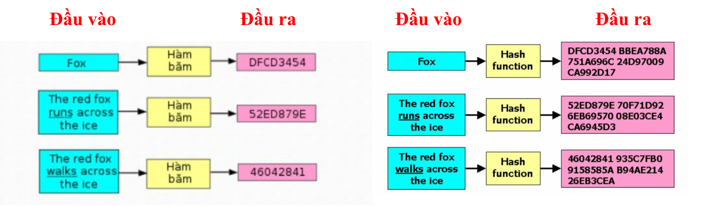
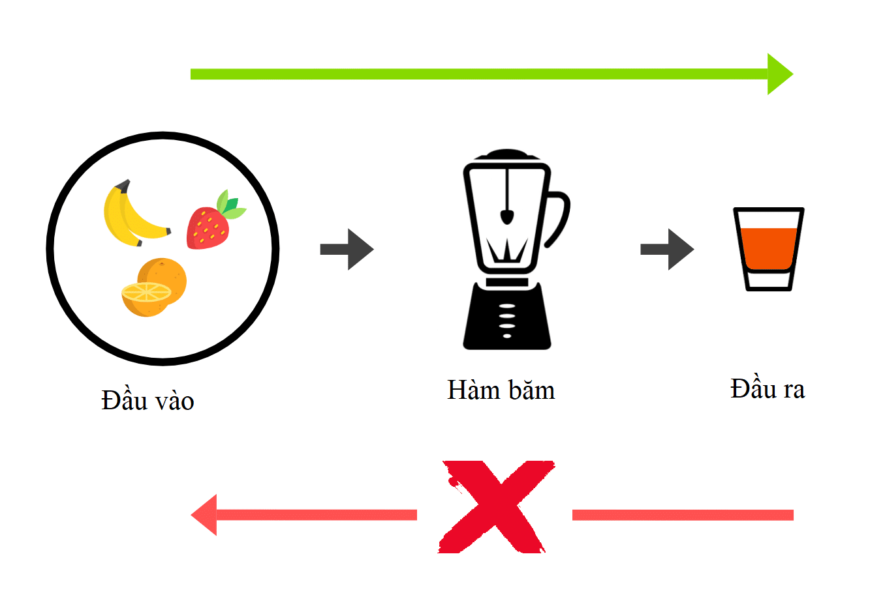
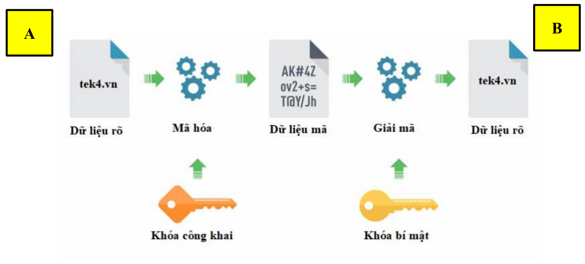
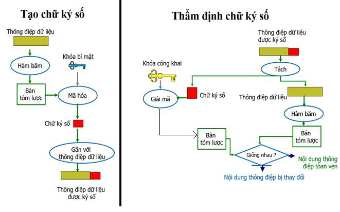
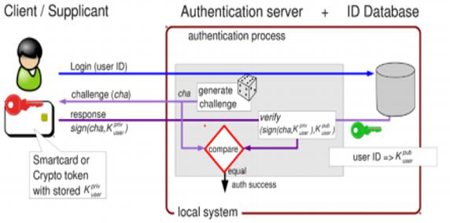
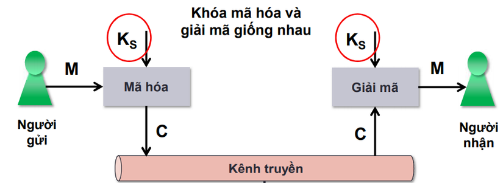
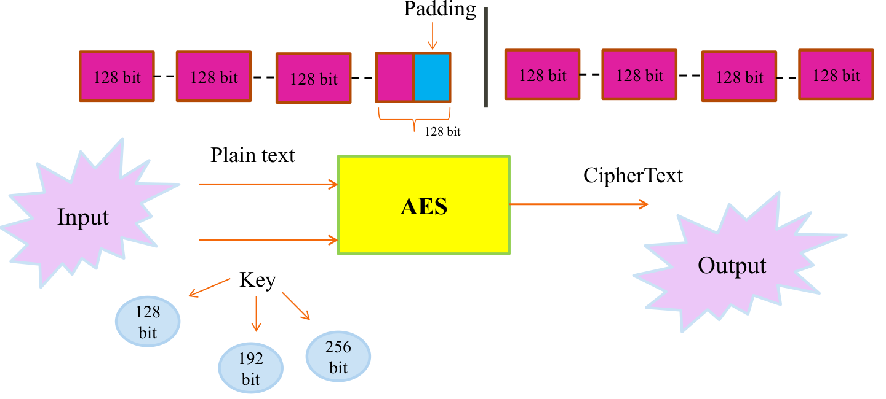

# Bài thực hành 6 Mật mã trong Java Card

> Nguồn: `141028217-1764207055310-baithuchanh6-matmatrongjavacard.pdf` · 13 slide · ThS. Cao Vinh, Khoa Công nghệ thông tin, Học viện Kỹ thuật Mật mã
> Chuyển từ PDF sang Markdown ngày 03/11/2026. Hình giữ dạng ảnh; chữ, mã và thông số trong hình được chép lại ngay dưới ảnh.

## Slide 1 · Trang bìa

- HỌC VIỆN KỸ THUẬT MẬT MÃ
- KHOA CÔNG NGHỆ THÔNG TIN
- Bài thực hành 6
- Mật mã trong Java Card
- ThS. Cao Vinh
- caovinh226@gmail.com
- “Tri thức là chìa khóa mở cánh cửa tương lai"

## Slide 2 · Hàm băm (Hash function)

- ***Ý nghĩa***

  Hàm băm là quá trình biến đổi từ ***khối dữ liệu có độ dài bất kì*** sinh ra ***giá trị băm có độ dài xác định.***

- ***Ví dụ***

  ***Một số thuật toán của hàm băm:***

  MD5 có độ dài đầu ra là 128 bit (16 byte)

  SHA-1 có độ dài đầu ra là 160 bit (20 byte)

  SHA-256 có độ dài đầu ra là 256 bit (32 byte)

## Slide 3 · Hàm băm (Hash function)

Chữ trong hình:

- Nhãn phía trên hai hình, từ trái sang phải: Đầu vào, Đầu ra, Đầu vào, Đầu ra (mỗi hình có Đầu vào ở cột trái, Đầu ra ở cột phải)
- Hình bên trái:
  - Fox → Hàm băm → DFCD3454
  - The red fox runs across the ice → Hàm băm → 52ED879E
  - The red fox walks across the ice → Hàm băm → 46042841
- Hình bên phải:
  - Fox → Hash function → DFCD3454 BBEA788A 751A696C 24D97009 CA992D17
  - The red fox runs across the ice → Hash function → 52ED879E 70F71D92 6EB69570 08E03CE4 CA6945D3
  - The red fox walks across the ice → Hash function → 46042841 935C7FB0 9158585A B94AE214 26EB3CEA
- Trong cả hai hình, từ “runs” và “walks” được gạch chân.

## Slide 4 · Hàm băm (Hash function)

Chữ trong hình:

- Đầu vào (hình trái cây) → Hàm băm (hình máy xay sinh tố) → Đầu ra (hình cốc nước ép)
- Mũi tên xanh lá phía trên chỉ chiều từ trái sang phải; mũi tên đỏ phía dưới chỉ chiều ngược lại và bị gạch bằng dấu X đỏ.

## Slide 5 · Hàm băm (Hash function)

- ***Tính chất của hàm băm***
  - Hàm băm là hàm một chiều
  - Với mỗi 1 đầu vào ngẫu nhiên, hàm băm phải tạo ra được 1 và chỉ 1 giá trị băm tương ứng

  → đầu vào khác nhau phải xuất ra các giá trị băm khác nhau

  ***Lưu ý:*** Có thể xảy ra xung đột giá trị băm (đầu vào khác nhau cho giá trị băm giống nhau)

## Slide 6 · Mật mã khóa công khai

- ***Tính chất***

  Mật mã hóa khóa công khai là một dạng mật mã cho phép người sử dụng trao đổi các thông tin mật mà ***không cần*** phải trao đổi các ***khóa*** chung bí mật trước đó. Điều này được thực hiện bằng cách sử dụng một cặp khóa có quan hệ toán học với nhau:

  - khóa công khai
  - khóa bí mật

## Slide 7 · Mật mã khóa công khai

- ***Ứng dụng***

  Có 3 ứng dụng chính:

  - Ứng dụng trong mã hóa, giải mã
  - Ứng dụng trong chữ ký số (Digital Signature)
  - Ứng dụng trong xác thực

- ***Ví dụ***

  RSA, ECC

## Slide 8 · Ứng dụng mã hóa, giải mã

Chữ trong hình:

- Ô nhãn A ở góc trên bên trái, ô nhãn B ở góc trên bên phải
- Dữ liệu rõ (tệp ghi `tek4.vn`) → Mã hóa → Dữ liệu mã (tệp ghi `AK#4Z` `ov2+s=` `T@Y/Jh`) → Giải mã → Dữ liệu rõ (tệp ghi `tek4.vn`)
- Khóa công khai → Mã hóa
- Khóa bí mật → Giải mã

## Slide 9 · Ứng dụng trong chữ ký số (Digital Signature)

Chữ trong hình:

- Tạo chữ ký số
  - Thông điệp dữ liệu → Hàm băm → Bản tóm lược → Mã hóa
  - Khóa bí mật → Mã hóa
  - Mã hóa → Chữ ký số → Gắn với thông điệp dữ liệu → Thông điệp dữ liệu được ký số
- Thẩm định chữ ký số
  - Thông điệp dữ liệu được ký số → Tách
  - Tách → Chữ ký số → Giải mã; Khóa công khai → Giải mã; Giải mã → Bản tóm lược
  - Tách → Thông điệp dữ liệu → Hàm băm → Bản tóm lược
  - Hai Bản tóm lược → Giống nhau ? → Nội dung thông điệp toàn vẹn (mũi tên sang phải) hoặc Nội dung thông điệp bị thay đổi (mũi tên xuống dưới)

## Slide 10 · Ứng dụng trong xác thực

Chữ trong hình:

- Bên trái: Client / Supplicant (hình người dùng và thẻ có chìa khóa đỏ); chú thích của thẻ: Smartcard or Crypto token with stored Kprivuser
- Bên phải: Authentication server + ID Database; khung authentication process nằm trong khung local system
- Login (user ID): mũi tên từ Client tới ID Database
- generate challenge → challenge (cha) → Client; nhánh cha → compare
- response sign(cha,Kprivuser): đường từ thẻ tới ô verify (sign(cha,Kprivuser),Kpubuser)
- Đường nối từ ID Database tới ô verify, cạnh hình chìa khóa xanh và ô user ID => Kpubuser
- verify → compare → equal → auth success

## Slide 11 · Mật mã khóa bí mật

- ***Tính chất***

  ***Mật mã khóa bí mật***, còn gọi là ***mật mã khóa đối xứng*** hay ***mật mã khóa riêng***, là sử dụng **một khóa** cho cả quá trình mã hóa và quá trình giải mã.

Chữ trong hình (nhãn trên mũi tên ghi trong ngoặc):

- Người gửi → (M) → Mã hóa → (C) → Kênh truyền → (C) → Giải mã → (M) → Người nhận
- KS → Mã hóa; KS → Giải mã (cả hai KS được khoanh tròn đỏ)
- Dòng chữ ở giữa: Khóa mã hóa và giải mã giống nhau

## Slide 12 · Mật mã khóa bí mật

- ***Ứng dụng***

  Mã hóa dữ liệu

- ***Ví dụ***

  AES, DES,…

## Slide 13 · Mã khối AES

Chữ trong hình:

- Hàng trên, bên trái vạch đứng: các khối 128 bit, 128 bit, 128 bit nối bằng nét đứt, rồi một khối cuối gồm phần dữ liệu và phần Padding (mũi tên Padding chỉ vào phần màu xanh; dấu ngoặc dưới khối cuối ghi 128 bit)
- Hàng trên, bên phải vạch đứng: các khối 128 bit, 128 bit, 128 bit, 128 bit nối bằng nét đứt
- Input → AES: hai mũi tên, nhãn Plain text ở trên mũi tên thứ nhất, nhãn Key ở dưới mũi tên thứ hai
- Key → 128 bit, 192 bit, 256 bit
- AES → CipherText → Output
